# تقرير التدقيق الفني الشامل لقاعدة البيانات (Database Audit Report)

**تاريخ التدقيق:** 2026-11-01  
**الدور:** مدقق أول مستقل (Senior Independent Auditor)  
**الحالة:** تدقيق للقراءة فقط (Read-Only) دون تعديل أي ملفات مصدرية أو تهيئة أو بيانات  
**قاعدة البيانات المفحوصة:** `MarketplaceMVP_test` (PostgreSQL 18.6 on x86_64-windows)  

---

## 1. الخلاصة التنفيذية وأبرز المخاطر (Verdict and Top Risks)

أظهر الفحص الشامل لمخطط قاعدة البيانات وسجلات الترحيل (EF Core Migrations) والكود المصدري لمنصة السوق (Marketplace) وجود بنية هيكلية واسعة تشمل 28 جدولاً تطبيقياً و277 عموداً و47 مفتاحاً أجنبياً و89 فهرساً [V: `scripts/audit2/catalog_inventory_output.txt`]. وعلى الرغم من التزام المشروع بتمثيل المبالغ المالية بنوع `numeric(18,2)` وتوحيد التوقيت عبر `timestamp with time zone`، إلا أن التدقيق كشف عن مخاطر جسيمة تهدد سلامة البيانات والأداء والاستقرار المالي:

1. **انعدام آليات منع التحديثات المفقودة (Lost Updates) في المحافظ المالية [DB-001 - BLOCKER]:**  
   لا تحتوي جداول المحافظ `VendorWallets` و `BuyerWallets` على رموز تطابق تسلسلي (`RowVersion` أو `xmin` أو `[ConcurrencyCheck]`). يتم تحديث الأرصدة عبر قراءة الكيان ثم تعديله وحفظه برمجياً داخل الذاكرة [V: `backend/Marketplace.Application/Services/WalletService.cs:144-158`]، مما يفتح الباب لحدوث Race Conditions وسحوبات متزامنة تفوق الرصيد الحقيقي.
2. **غياب كامل لقيود التحقق المنطقية في قاعدة البيانات (Zero Domain CHECK Constraints) [DB-002 - BLOCKER]:**  
   لا يوجد قيد تحقق واحد (CHECK constraint) يضمن عدم هبوط الأرصدة أو المخزون تحت الصفر [V: `information_schema.check_constraints WHERE check_clause NOT LIKE '%IS NOT NULL%'` أعاد 0 صفوف]. إذا فشل كود التطبيق، تسمح قاعدة البيانات فوراً بأرصدة ومخزون سالب.
3. **انهيار أداء استعلامات الطلبات بسبب حذف الفهرس الأساسي [DB-003 - HIGH]:**  
   قامت الهجرة `20261027172857` بحذف الفهرس `IX_Orders_BuyerId` واستبداله بفهرس جزئي مشروط بوجود مفتاح اللاتكرار `IdempotencyKey` [V: `scripts/audit2/all-migrations.sql:869`]. نتيجة لذلك، تؤدي استعلامات طلبات المشتري أو عمليات الفحص المرجعي لحذف المستخدمين إلى مسح تسلسلي كامل لجدول الطلبات (`Seq Scan on Orders`) [V: أمر EXPLAIN عبر `scripts/audit2/test_explain_orders.sql`].
4. **تخزين أسرار المصادقة الثنائية كنص صريح (Plaintext 2FA Secrets) [DB-004 - HIGH]:**  
   يتم حفظ السر `TwoFactorSecret` كنص صريح بصيغة Base32 داخل العمود `Users.TwoFactorSecret` دون أي تشفير أثناء السكون [V: `backend/Marketplace.Application/Services/TotpService.cs:11-20` و `AppDbContext.cs:95-97`].
5. **انحراف تزامني بين ملفات الهجرة وقاعدة البيانات الحية (Migration Drift) [DB-005 - HIGH]:**  
   سجل جدول `__EFMigrationsHistory` في قاعدة الاختبار الهجرة `20261028015637_AddAdminAuditLogsAndCategoryBilingualNames` مع قيد حذف `ON DELETE SET NULL`، بينما الملف البرمجي المقابل في الكود يحمل المعرف `20261028024709` مع قيد `ON DELETE RESTRICT` [V: `scripts/audit2/catalog_inventory_output.txt` و `20261028024709_AddAdminAuditLogsAndCategoryBilingualNames.Designer.cs:15`].
6. **مسح كامل للجدول في محرك البحث بسبب فهرس B-tree على `SearchVector` [DB-006 - HIGH]:**  
   يتم البحث عن المنتجات عبر تجزئة الكلمات ومطابقة `LIKE '%term%'`، بينما العمود مفهرس باستخدام B-tree فقط [V: `AppDbContext.cs:342`] مع غياب تام لإضافة `pg_trgm` في الخادم [V: `pg_extension`].
7. **مخاطر محو البيانات الكارثي في دوال التراجع `Down()` للهجرات [DB-007 - HIGH]:**  
   تحتوي 17 هجرة من أصل 21 على تعليمات `DropTable` و `DropColumn` غير مشروطة في دوال التراجع، دون وجود استثناءات حماية لمنع التدمير العرضي للبيانات [V: `scripts/audit2/audit_migrations_hygiene.js`].
8. **الاتصال بصلاحيات المستخدم الخارق (Superuser) وغياب تشفير النقل (TLS) [DB-009 - MEDIUM]:**  
   يتصل التطبيق بقاعدة البيانات كمستخدم `postgres` المالك للنظام دون تفعيل إلزامي لـ `SSL Mode=Require` [V: `backend/Marketplace.API/appsettings.json:3`].

---

## 2. جرد مخطط قاعدة البيانات (Schema Inventory)

تم استخراج الجرد الكامل عبر فحص كتالوج PostgreSQL الحي في `MarketplaceMVP_test` ومطابقته مع ملف لقطة الموديل `AppDbContextModelSnapshot.cs` وملف الترحيلات المجمعة `scripts/audit2/all-migrations.sql`.

### 2.1 ملخص الكيانات
* **إجمالي الجداول:** 29 جدولاً (28 جدولاً تطبيقياً + جدول تاريخ الهجرات `__EFMigrationsHistory`) [V].
* **إجمالي الأعمدة:** 277 عموداً [V].
* **المفاتيح الأساسية:** 29 مفتاحاً أساسياً (جميع الجداول تستخدم `Id` كمعرف عددي توليدي `integer GENERATED BY DEFAULT AS IDENTITY` ما عدا `__EFMigrationsHistory` بمفتاح نصي `MigrationId`) [V].
* **المفاتيح الأجنبية:** 47 قيد علاقة خارجية [V].
* **الفهارس الإجمالية:** 89 فهرساً (تشمل 29 فهرس مفتاح أساسي و60 فهرساً عادياً وفريداً وجزئياً) [V].
* **القيود المنطقية المخصصة (Domain CHECK Constraints):** 0 قيد [V].
* **الإضافات المثبتة (Extensions):** إضافة `plpgsql` فقط (الإصدار 1.0) [V].
* **المشاهد (Views):** 0 مشهد [V].
* **المشغلات (Triggers):** 0 مشغل [V].

### 2.2 جدول مواصفات الجداول والأعمدة والأنواع المالية والزمنية

| اسم الجدول (`Table`) | الغرض الوظيفي | عدد الأعمدة | الأعمدة النقدية (`numeric(18,2)`) | الأعمدة الزمنية (`timestamptz`) | الأعمدة النصية الحرة / JSON |
| :--- | :--- | :---: | :--- | :--- | :--- |
| `Users` | حسابات المستخدمين (مشترين، بائعين، مدراء) | 13 | لا يوجد | `CreatedAt`, `EmailVerifiedAt`, `PhoneVerifiedAt` | `PasswordHash` (text) |
| `SellerProfiles` | الملف التجاري وموقع مستودع الشحن للبائع | 5 | لا يوجد | لا يوجد | `DispatchAddress` (varchar 300) |
| `UserAddresses` | العناوين الجغرافية للمشترين وبيانات التوصيل | 16 | لا يوجد (الإحداثيات `double precision`) | `CreatedAt` | `FormattedAddress` (varchar 500) |
| `Categories` | التصنيفات والتبويب الثنائي اللغات | 7 | لا يوجد | لا يوجد | `IconName` (varchar 50) |
| `Products` | بيانات المنتجات والأسعار والمخزون | 20 | `Price`, `OldPrice`, `AverageRating` (`numeric(3,2)`) | `CreatedAt` | `ImageUrls` (text JSON), `SearchVector` (text) |
| `ProductVariants` | المتغيرات السلعية (اللون، المقاس، السعر الخاص) | 8 | `PriceOverride` | لا يوجد | `Sku` (varchar 100) |
| `Orders` | طلبات الشراء وبيانات المستلم والدفع | 19 | `TotalAmount`, `DiscountAmount`, `WalletAmountUsed` | `CreatedAt` | `RecipientPhone` (varchar 20) |
| `OrderItems` | بنود الطلب المرتبطة بالمنتجات والشحنات | 7 | `UnitPrice` | لا يوجد | `VariantSummary` (varchar 200) |
| `Shipments` | شحنات البائعين والتحصيل عند الاستلام (COD) | 16 | `DeliveryCost`, `CodAmount`, `ReceivedAmount` | `CreatedAt`, `DeliveredAt`, `CodSettledAt` | `SettlementReference` (varchar 100) |
| `VendorWallets` | محافظ البائعين (الأرصدة المتاحة والمعلقة) | 6 | `Balance`, `PendingBalance`, `TotalEarned` | `UpdatedAt` | لا يوجد |
| `WalletTransactions` | سجل قيود حركات محفظة البائع | 7 | `Amount` | `CreatedAt` | `Description` (varchar 250) |
| `PayoutRequests` | طلبات سحب الأرباح لحسابات البنك والمحافظ | 9 | `Amount` | `CreatedAt`, `ProcessedAt` | `DestinationAccount` (varchar 150) |
| `BuyerWallets` | محفظة المشتري (الاستردادات ونقاط الولاء) | 3 | `Balance` | `UpdatedAt` | لا يوجد |
| `BuyerWalletTransactions`| قيود حركات محفظة المشتري | 7 | `Amount` | `CreatedAt` | `Description` (varchar 250) |
| `Coupons` | قسائم الخصم وشروط استخدامها | 12 | `DiscountValue`, `MinOrderSubtotal`, `MaxDiscountAmount` | `CreatedAt`, `ExpiresAt` | `Code` (varchar 50) |
| `CouponUsages` | سجل استخدام القسائم لكل مشتري | 5 | `DiscountApplied` | `UsedAt` | لا يوجد |
| `Reviews` | تقييمات المشترين وتعليقاتهم وردود البائعين | 11 | لا يوجد | `CreatedAt`, `UpdatedAt`, `HiddenAt`, `SellerRepliedAt` | `ImageUrls` (text JSON), `Comment` (varchar 1000) |
| `ReviewReports` | بلاغات الإبلاغ عن مراجعات مسيئة | 5 | لا يوجد | `CreatedAt` | `Details` (varchar 500) |
| `WishlistItems` | قائمة رغبات المشتري | 4 | لا يوجد | `CreatedAt` | لا يوجد |
| `ReturnRequests` | طلبات الإرجاع واسترداد الأموال | 11 | `RefundAmount` | `CreatedAt`, `ResolvedAt` | `Reason` (varchar 500) |
| `UserDeviceTokens` | معرفات أجهزة الإشعارات اللحظية (Push) | 5 | لا يوجد | `UpdatedAt` | `DeviceToken` (varchar 500) |
| `UserNotifications` | إشعارات النظام الموجهة للمستخدمين | 9 | لا يوجد | `CreatedAt` | `BodyAr`, `BodyEn` (varchar 1000) |
| `VerificationCodes` | رموز التحقق المؤقتة (OTP) وتجزئتها | 9 | لا يوجد | `CreatedAt`, `ExpiresAt`, `ConsumedAt` | `CodeHash` (varchar 256) |
| `RefreshTokens` | رموز تجديد جلسات المصادقة (JWT Refresh) | 10 | لا يوجد | `CreatedAt`, `ExpiresAt`, `LastUsedAt`, `RevokedAt` | `TokenHash` (varchar 64) |
| `UploadedFiles` | سجل الملفات والصور المرفوعة وسعاتها | 9 | لا يوجد | `CreatedAt` | `RelativeUrl` (varchar 150) |
| `UserConsents` | موافقات سياسة الخصوصية وقانون حماية البيانات | 5 | لا يوجد | `AcceptedAt` | `PolicyVersion` (varchar 20) |
| `ExternalLogins` | حسابات المصادقة الخارجية (Google OAuth) | 5 | لا يوجد | `CreatedAt` | `Subject` (varchar 255) |
| `AdminAuditLogs` | سجل العمليات الرقابية للمدراء | 7 | لا يوجد | `CreatedAt` | `Details` (varchar 2000) |
| `__EFMigrationsHistory` | السجل التاريخي لهجرات الكيان في قاعدة البيانات | 2 | لا يوجد | لا يوجد | `MigrationId` (varchar 150) |

---

## 3. مخطط علاقات الكيانات (ER Summary & Diagram)

### 3.1 جدول ملخص الكيانات وعلاقات الملكية

| الكيان (`Entity`) | الكيان المالك (`Owner`) | المفتاح الأساسي (`PK`) | المفاتيح الأجنبية وقواعد الحذف (`FKs & On Delete`) |
| :--- | :--- | :--- | :--- |
| `Users` | جذر النظام (Root) | `Id` | لا يوجد |
| `SellerProfiles` | `Users` (1:1) | `Id` | `UserId` -> `Users.Id` (`CASCADE`) |
| `UserAddresses` | `Users` (1:N) | `Id` | `UserId` -> `Users.Id` (`CASCADE`) |
| `UserConsents` | `Users` (1:N) | `Id` | `UserId` -> `Users.Id` (`RESTRICT`) |
| `ExternalLogins` | `Users` (1:N) | `Id` | `UserId` -> `Users.Id` (`CASCADE`) |
| `UserDeviceTokens` | `Users` (1:N) | `Id` | `UserId` -> `Users.Id` (`CASCADE`) |
| `VerificationCodes`| `Users` (1:N) | `Id` | `UserId` -> `Users.Id` (`CASCADE`) |
| `RefreshTokens` | `Users` (1:N) | `Id` | `UserId` -> `Users.Id` (`CASCADE`), `ReplacedByTokenId` -> `RefreshTokens.Id` (`RESTRICT`) |
| `UserNotifications`| `Users` (1:N) | `Id` | `UserId` -> `Users.Id` (`CASCADE`) |
| `AdminAuditLogs` | `Users` (1:N) | `Id` | `AdminId` -> `Users.Id` (`SET NULL` في القاعدة الحية، `RESTRICT` في الكود) |
| `Categories` | مستقل | `Id` | لا يوجد |
| `Products` | `Users` (البائع) | `Id` | `SellerId` -> `Users.Id` (`RESTRICT`), `CategoryId` -> `Categories.Id` (`RESTRICT`) |
| `ProductVariants` | `Products` (1:N) | `Id` | `ProductId` -> `Products.Id` (`CASCADE`) |
| `UploadedFiles` | `Users` (الرافع) | `Id` | `UploaderId` -> `Users.Id` (`CASCADE`) |
| `WishlistItems` | `Users` (1:N) | `Id` | `UserId` -> `Users.Id` (`CASCADE`), `ProductId` -> `Products.Id` (`CASCADE`) |
| `Reviews` | `Products` / `Users` | `Id` | `ProductId` -> `Products.Id` (`CASCADE`), `BuyerId` -> `Users.Id` (`CASCADE`) |
| `ReviewReports` | `Reviews` / `Users` | `Id` | `ReviewId` -> `Reviews.Id` (`CASCADE`), `ReporterId` -> `Users.Id` (`CASCADE`) |
| `Coupons` | `Users` (البائع) | `Id` | `SellerId` -> `Users.Id` (`RESTRICT`) |
| `CouponUsages` | `Coupons` / `Users` | `Id` | `CouponId` -> `Coupons.Id` (`CASCADE`), `BuyerId` -> `Users.Id` (`CASCADE`), `OrderId` -> `Orders.Id` (`CASCADE`) |
| `Orders` | `Users` (المشتري) | `Id` | `BuyerId` -> `Users.Id` (`RESTRICT`) |
| `OrderItems` | `Orders` / `Shipments` | `Id` | `OrderId` -> `Orders.Id` (`CASCADE`), `ShipmentId` -> `Shipments.Id` (`CASCADE`), `ProductId` -> `Products.Id` (`RESTRICT`), `VariantId` -> `ProductVariants.Id` (`SET NULL`) |
| `Shipments` | `Orders` / `Users` | `Id` | `OrderId` -> `Orders.Id` (`CASCADE`), `SellerId` -> `Users.Id` (`RESTRICT`), `SettledByAdminId` -> `Users.Id` (`SET NULL`) |
| `ReturnRequests` | `Orders` / `Users` | `Id` | `OrderId` -> `Orders.Id` (`RESTRICT`), `ShipmentId` -> `Shipments.Id` (`RESTRICT`), `OrderItemId` -> `OrderItems.Id` (`RESTRICT`), `BuyerId` -> `Users.Id` (`RESTRICT`), `SellerId` -> `Users.Id` (`RESTRICT`) |
| `VendorWallets` | `Users` (البائع 1:1)| `Id` | `SellerId` -> `Users.Id` (`CASCADE`) |
| `WalletTransactions`| `VendorWallets` (1:N)| `Id` | `WalletId` -> `VendorWallets.Id` (`CASCADE`), `OrderId` -> `Orders.Id` (`SET NULL`), `ShipmentId` -> `Shipments.Id` (`SET NULL`) |
| `PayoutRequests` | `Users` (البائع) | `Id` | `SellerId` -> `Users.Id` (`CASCADE`) |
| `BuyerWallets` | `Users` (المشتري 1:1)| `Id` | `BuyerId` -> `Users.Id` (`CASCADE`) |
| `BuyerWalletTransactions`| `BuyerWallets` (1:N)| `Id` | `BuyerWalletId` -> `BuyerWallets.Id` (`NO ACTION`), `BuyerId` -> `Users.Id` (`CASCADE`), `OrderId` -> `Orders.Id` (`SET NULL`), `ReturnRequestId` -> `ReturnRequests.Id` (`SET NULL`) |

### 3.2 مخطط العلاقات (Mermaid Diagram)

```mermaid
erDiagram
    Users ||--o| SellerProfiles : has
    Users ||--o{ UserAddresses : registers
    Users ||--o{ UserConsents : accepts
    Users ||--o{ ExternalLogins : owns
    Users ||--o{ UserDeviceTokens : registers
    Users ||--o{ VerificationCodes : requests
    Users ||--o{ RefreshTokens : authenticates
    Users ||--o{ UserNotifications : receives
    Users ||--o{ AdminAuditLogs : audits
    Users ||--o{ Products : sells
    Users ||--o{ UploadedFiles : uploads
    Users ||--o{ WishlistItems : saves
    Users ||--o{ Reviews : writes
    Users ||--o{ ReviewReports : submits
    Users ||--o{ Coupons : issues
    Users ||--o{ CouponUsages : applies
    Users ||--o{ Orders : places
    Users ||--o| VendorWallets : holds
    Users ||--o{ PayoutRequests : requests
    Users ||--o| BuyerWallets : holds
    Users ||--o{ BuyerWalletTransactions : conducts

    Categories ||--o{ Products : categorizes
    Products ||--o{ ProductVariants : provides
    Products ||--o{ OrderItems : ordered_as
    Products ||--o{ Reviews : reviewed_under
    Products ||--o{ WishlistItems : listed_in

    Orders ||--o{ OrderItems : contains
    Orders ||--o{ Shipments : divides_into
    Orders ||--o{ CouponUsages : applies
    Orders ||--o{ ReturnRequests : requests_return
    Orders ||--o{ WalletTransactions : references
    Orders ||--o{ BuyerWalletTransactions : references

    Shipments ||--o{ OrderItems : delivers
    Shipments ||--o{ ReturnRequests : returns
    Shipments ||--o{ WalletTransactions : references

    VendorWallets ||--o{ WalletTransactions : records
    BuyerWallets ||--o{ BuyerWalletTransactions : logs
    Reviews ||--o{ ReviewReports : flagged_by
    RefreshTokens ||--o| RefreshTokens : replaced_by
```



---

## 4. جدول الملاحظات والثغرات (Findings Table)

| المعرف (`ID`) | الأهمية (`Severity`) | العنوان والملاحظة | الأدلة الإثباتية (`Evidence`) | الأثر (`Impact`) | سيناريو إعادة الإنتاج (`Reproduction`) | المقترح التصحيحي (`Fix Proposal`) | الفحص المطلوب إضافته (`Test to Add`) | الجهد (`Effort`) |
| :--- | :---: | :--- | :--- | :--- | :--- | :--- | :--- | :---: |
| **DB-001** | **BLOCKER** | غياب توكنات التزامن وخطر التحديث المفقود على الأرصدة | `WalletService.cs:144-158`, عدم وجود `xmin` أو `RowVersion` في `AppDbContext.cs:626-652` [V] | فقدان الأموال وسحوبات مزدوجة عبر طلبات متزامنة | إرسال طلبي سحب متزامنين بنفس القيمة لمستخدم واحد | إضافة `.IsRowVersion()` أو إجراء الخصم الذري عبر `UPDATE ... WHERE Balance >= amount` | اختبار تزامن متوازي لطلبات السحب | M |
| **DB-002** | **BLOCKER** | انعدام قيود التحقق المنطقية في قاعدة البيانات (`CHECK Constraints`) | استعلام `information_schema.check_constraints` يعيد 0 قيود تخص مجال العمل [V] | إمكانية نزول الأرصدة والمخزون تحت الصفر وقبول قيم سالبة | تنفيذ `UPDATE "VendorWallets" SET "Balance" = -100` فيقبلها الخادم مباشرة | إضافة قيود `CHECK` على الأرصدة والمخزون والتقييمات | اختبار محاولة إدخال رصيد أو مخزون سالب والتحقق من الرفض | S |
| **DB-003** | **HIGH** | مسح تسلسلي لجدول الطلبات بسبب حذف فهرس `IX_Orders_BuyerId` | ملف الهجرة `all-migrations.sql:869` يحذف الفهرس ونتيجة EXPLAIN تظهر `Seq Scan` [V] | تدهور أسّي في أداء استعلام طلبات المشتري عند وصول حجم الجدول لمئات الآلاف | تشغيل `EXPLAIN SELECT * FROM "Orders" WHERE "BuyerId" = 1` | إنشاء الفهرس المركب `IX_Orders_BuyerId_CreatedAt` | اختبار خطة الاستعلام والتأكد من استخدام `Index Scan` | S |
| **DB-004** | **HIGH** | تخزين أسرار المصادقة الثنائية (2FA) كنص صريح دون تشفير | `TotpService.cs:11-20` يخزن السر كنص Base32 مجرد داخل `Users.TwoFactorSecret` [V] | تسريب كامل للرموز وتجاوز المصادقة في حال تسرب نسخة احتياطية أو وصول للقاعدة | قراءة عمود `TwoFactorSecret` مباشرة من جدول `Users` | تشفير السر باستخدام خوارزمية AES-256-GCM أو `IDataProtector` قبل التخزين | اختبار وحدة للتحقق من أن المخزن في القاعدة هو نص مشفر | M |
| **DB-005** | **HIGH** | انحراف معرف وتفاصيل الهجرة بين الكود وقاعدة البيانات الحية | وجود `20261028015637` بـ `SET NULL` في القاعدة مقابل `20261028024709` بـ `RESTRICT` في الكود [V] | فشل ترحيل قواعد البيانات وتوقف الـ Deployment التلقائي لاختلاف التاريخ | تشغيل `dotnet ef database update` على بيئة تحتوي السجل القديم | توحيد ملف الهجرة وسجل `__EFMigrationsHistory` بنص تصحيحي صريح | اختبار مقارنة تلقائي لملفات الهجرة مع السجل الحي | S |
| **DB-006** | **HIGH** | استخدام فهرس B-Tree على `SearchVector` وغياب `pg_trgm` | `AppDbContext.cs:342`, `SearchService.cs:100`, غياب الإضافة في `pg_extension` [V] | عجز الفهرس عن خدمة مطابقة الأجزاء `LIKE '%x%'` واللجوء للمسح التسلسلي الكامل | تشغيل `EXPLAIN` على استعلام يحتوي `SearchVector LIKE '%word%'` | تثبيت إضافة `pg_trgm` وإنشاء فهرس GIN ثلاثي المقاطع | فحص سرعة البحث وخطة الاستعلام تحت ضغط 50 ألف منتج | M |
| **DB-007** | **HIGH** | احتواء دوال التراجع `Down()` على عمليات محو بيانات مدمرة | 17 هجرة تحتوي على `DropTable` و `DropColumn` صريحة في `Down()` [V] | مسح جداول الإنتاج كاملة إذا تم استدعاء تراجع عن طريق الخطأ | استدعاء `Down()` لإحدى الهجرات السابقة في بيئة تجريبية | استبدال المحو برمي استثناء `NotSupportedException` صريح في دوال `Down()` | اختبار فحص كودي ساكن يرفض أي `Down()` تخريبي | S |
| **DB-008** | **MEDIUM** | فهارس البريد والهاتف حساسة لحالة الأحرف وتسمح بالحسابات المكررة | `AppDbContext.cs:57-67`، الفهرس مباشر على `Email` و `Phone` [V] | إنشاء حسابات متعددة لنفس البريد باختلاف الأحرف الكبيرة والصغيرة | إدخال `User@test.com` ثم `user@test.com` فيتم قبولهما معاً | إنشاء فهرس فريد على التعبير `lower("Email")` أو استخدام نوع `citext` | اختبار تكامل لإدخال بريد مكرر بأحرف كبيرة | S |
| **DB-009** | **MEDIUM** | الاتصال بصلاحية المدير العام وتجريد الاتصال من تشفير النقل | `appsettings.json:3` يحدد `Username=postgres` دون وسيط `SSL Mode=Require` [V] | تشغيل الكود بأعلى صلاحيات والتنصت على البيانات الشخصية عبر الشبكة | استعلام `SHOW is_superuser` يعيد `on` | إنشاء دور `marketplace_app` مخصص بالحد الأدنى من الصلاحيات وتفعيل TLS | فحص أمني يؤكد أن مستخدم الاتصال ليس superuser | S |
| **DB-010** | **MEDIUM** | تراكم لانهائي لرموز التجديد `RefreshTokens` دون خدمة تنظيف | عدم وجود خلفية تنظيف لـ `RefreshTokens` في `Marketplace.Infrastructure/BackgroundServices/` [V] | تضخم حجم الجدول والفهارس وبطء عمليات التحقق مع مرور الزمن | حساب عدد الرموز منتهية الصلاحية مع الزمن | إنشاء `RefreshTokenCleanupService` لحذف الرموز المنتهية أقدم من 30 يوماً | اختبار تنظيف دوري للرموز المنتهية | S |
| **DB-011** | **MEDIUM** | إمكانية تسجيل أكثر من عنوان افتراضي لنفس المستخدم | عمود `UserAddresses.IsDefault` يفتقر لفهرس فريد جزئي [V] | اضطراب تحديد عنوان الشحن الافتراضي أثناء Checkout للمشتري | إدخال عنوانين لنفس المستخدم مع `IsDefault = true` | إنشاء فهرس فريد جزئي `WHERE "IsDefault" = true` لكل مستخدم | اختبار رفض إضافة عنوان افتراضي ثانٍ دون إلغاء الأول | S |
| **DB-012** | **LOW** | استنزاف الذاكرة عبر الترقيم القائم على الإزاحة (`OFFSET Pagination`) | `ProductService.cs:473` و `AdminService.cs:153` تستخدم `Skip().Take()` [V] | بطء شديد في التصفح العميق واستهلاك غير مبرر لموارد الخادم | تنفيذ استعلام بـ `OFFSET 50000 LIMIT 20` ومقارنة زمن الاستجابة | الانتقال إلى Keyset/Cursor Pagination في الجداول الضخمة | اختبار مقارنة أداء الترقيم الإزاحي مقابل المفتاحي | M |

---

## 5. جرد البيانات الشخصية والحساسة (PII Inventory)

وفقاً لأحكام قانون حماية البيانات الشخصية المصري رقم 151 لسنة 2020، تم رصد كافة الحقول التي تمثل بيانات شخصية أو حساسة:

| الجدول والعمود (`Table.Column`) | تصنيف البيانات (`Category`) | الغرض الوظيفي (`Purpose`) | سياسة الاستبقاء (`Retention`) | هل يتم إخفاء الهوية عند الحذف؟ (`Anonymized?`) | مشمول في تصدير البيانات؟ (`Export?`) | مشمول في النسخ الاحتياطي؟ | احتمالية الظهور في السجلات (`Logs?`) |
| :--- | :--- | :--- | :--- | :---: | :---: | :---: | :---: |
| `Users.Name` | هوية شخصية | تحديد هوية صاحب الحساب | طوال فترة نشاط الحساب | نعم (يتم تحويله إلى اسم مجهول) [I] | نعم | نعم | منخفضة |
| `Users.Email` | اتصال وهوية | تسجيل الدخول والمراسلات | طوال فترة نشاط الحساب | نعم (يستبدل بقيمة مشوهة) [I] | نعم | نعم | محجوبة عبر `LogMasking` [V] |
| `Users.Phone` | اتصال وهوية | تسجيل الدخول واستلام الشحنات | طوال نشاط الحساب + مدة الضرائب | نعم (يتم تشويهه) [I] | نعم | نعم | محجوبة عبر `LogMasking` [V] |
| `Users.PasswordHash` | مصادقة أمنية | التحقق من كلمة المرور (BCrypt) | طوال نشاط الحساب | يتم حذفه/تصفيره [I] | لا | نعم | مستبعد كلياً [V] |
| `Users.TwoFactorSecret` | مصادقة حساسة | توليد رموز TOTP للمدراء | طوال تفعيل الـ 2FA | يحذف بتعطيل الميزة | لا | نعم | مستبعد كلياً [V] |
| `UserAddresses.*` | بيانات موقع وتوصيل | شحن الطرود وتحديد النطاق | طوال نشاط الحساب | يتم حذف السجلات [I] | نعم | نعم | منخفضة |
| `Orders.RecipientName` | هوية طرف مستلم | تسليم بوليصة الشحن | 5 سنوات (متطلب ضريبي مصري) [G] | لا (تاريخ الطلب المالي ثابت) [I] | نعم | نعم | منخفضة |
| `Orders.RecipientPhone` | اتصال طرف مستلم | تواصل مندوب الشحن | 5 سنوات (متطلب ضريبي مصري) [G] | لا (مرتبط بالشحنة) [I] | نعم | نعم | محجوبة جزئياً |
| `SellerProfiles.*` | بيانات موقع تجاري | استلام الشحنات من التاجر | طوال نشاط المتجر | تحذف بتعطيل المتجر | نعم | نعم | منخفضة |
| `PayoutRequests.DestinationAccount` | بيانات مالية حساسة | تحويل مستحقات البنك/المحفظة | 5 سنوات (متطلب محاسبي ورجوعي) [G]| تحفظ للتدقيق المالي | نعم | نعم | محجوبة جزئياً |
| `UserDeviceTokens.DeviceToken` | معرّف عتادي/تقني | دفع إشعارات Firebase/APNS | حتى استبدال الجهاز أو حذفه | تحذف تلقائياً | لا | نعم | مستبعد |
| `VerificationCodes.Target` | وسيلة اتصال | إرسال رمز التحقق OTP | تحذف بعد 24 ساعة عبر الخدمة [V] | نعم (تنظيف آلي) [V] | لا | نعم | محجوبة عبر `LogMasking` [V] |
| `VerificationCodes.CodeHash` | رمز أمني مجزأ | مقارنة رمز الدخول (HMAC-SHA256) | تحذف بعد 24 ساعة عبر الخدمة [V] | نعم (تنظيف آلي) [V] | لا | نعم | مستبعد |
| `RefreshTokens.DeviceId` | هوية الجهاز | تعقب الجلسات الفعالة | طوال صلاحية الجلسة | لا تحذف آلياً (ثغرة DB-010) [V]| لا | نعم | منخفضة |
| `ExternalLogins.Subject` | معرّف هوية خارجي | ربط حساب Google | طوال ربط الحساب | تحذف بحذف الحساب (`CASCADE`) [V]| نعم | نعم | منخفضة |
| `UserConsents.*` | إثبات قانوني | توثيق القبول بالقانون 151/2020 | طوال عمر النظام (سجل امتثال) [G] | لا تحذف (مرجع التزام قانوني) [G]| نعم | نعم | منخفضة |

> [!IMPORTANT]
> **ملاحظة الامتثال للقانون المصري رقم 151 لسنة 2020:**  
> تنص المادة (12) على التزام المتحكم باتخاذ الإجراءات والتدابير التقنية والتنظيمية لتأمين البيانات وسلامتها. حفظ أسرار الـ 2FA كنص صريح يمثل مخالفة صريحة لاشتراطات الأمن السيبراني. كما يوجب القانون إتاحة حق المحو للمستخدم، مع ضرورة المواءمة بين المحو والاحتفاظ بسجلات المعاملات التجارية والضريبية المقررة بقانون التجارة وقانون الضريبة على الدخل رقم 91 لسنة 2005.

---

## 6. مصفوفة القواعد الصارمة (Invariant Matrix)

توضح هذه المصفوفة أين يتم فرض قواعد العمل الحيوية: هل تتولى قاعدة البيانات فرضها بصورة قطعية، أم أنها تعتمد حصرياً على منطق التطبيق في الذاكرة.

| القاعدة وحتمية العمل (`Invariant Rule`) | فرض قاعدة البيانات (`DB Enforced`) | فرض كود التطبيق (`App Enforced`) | آلية الفرض في الكود (`Application Mechanism`) | مقترح القيد الصلب في قاعدة البيانات (`Proposed DB Constraint`) |
| :--- | :---: | :---: | :--- | :--- |
| **المخزون لا يقل عن الصفر (`Stock >= 0`)** | ❌ غير مفروض | ✅ مفروض | `UPDATE "Products" SET "Stock" = "Stock" - @q WHERE "Stock" >= @q` [V: `OrderService.cs:261`] | `ALTER TABLE "Products" ADD CONSTRAINT "CK_Products_Stock_NonNegative" CHECK ("Stock" >= 0);` |
| **أرصدة المحافظ موجبة (`Balance >= 0`)** | ❌ غير مفروض | ⚠️ جزئي (معرض لـ Race) | فحص برمجي `if (wallet.Balance < req.Amount)` في الذاكرة [V: `WalletService.cs:144`] | `ALTER TABLE "VendorWallets" ADD CONSTRAINT "CK_VendorWallets_Balance_NonNegative" CHECK ("Balance" >= 0);` |
| **مراجعة واحدة لكل مشترٍ ومنتج** | ✅ مفروض | ✅ مفروض | فحص مسبق في الكود | مفروض حالياً عبر الفهرس الفريد `IX_Reviews_ProductId_BuyerId` [V] |
| **عنوان افتراضي واحد فقط للمستخدم** | ❌ غير مفروض | ✅ مفروض | تعديل العناوين السابقة إلى `IsDefault = false` برمجياً | `CREATE UNIQUE INDEX "IX_UserAddresses_UserId_SingleDefault" ON "UserAddresses" ("UserId") WHERE "IsDefault" = true;` |
| **تسوية واحدة لكل شحنة (`Single Settlement`)** | ❌ غير مفروض | ✅ مفروض | فحص `if (shipment.IsCodSettled)` في الخدمة [V] | `CREATE UNIQUE INDEX "IX_Shipments_Single_Settlement" ON "Shipments" ("Id") WHERE "IsCodSettled" = true;` |
| **تطابق قيود الدفتر مع الأرصدة (`Ledger = Balance`)**| ❌ غير مفروض | ❌ غير متحقق (يوجد انحراف)| رصد التدقيق الحي 5 محافظ مشتري برصيد 100 دون أي قيود في الدفتر! [V] | إنشاء مشغل تدقيق أو الاعتماد على حساب الرصيد ديناميكياً من قيود المعاملات |
| **لاتكرار إنشاء الطلب (`Idempotency Key`)** | ✅ مفروض | ✅ مفروض | معالجة استثناء الفرادة في الكود [V: `OrderService.cs:590`] | مفروض حالياً عبر الفهرس الفريد الجزئي `IX_Orders_BuyerId_IdempotencyKey` [V] |
| **سلسلة تعاقب رموز التجديد (`Token Chain`)** | ⚠️ جزئي (فرادة الرمز فقط)| ✅ مفروض | فحص `RevokedAt` و `ReplacedByTokenId` في كود الخدمة [V] | ربط الرمز السابق بقيد مفتاح أجنبي `ON DELETE RESTRICT` (مطبق حالياً) |

---

## 7. مراجعة الفهارس وأداء الاستعلامات (Index Review)

### 7.1 الفهارس المفقودة والزائدة والجزئية
1. **الفهرس المفقود الأخطر (`IX_Orders_BuyerId`):**  
   حذف الفهرس عند إضافة حقل `IdempotencyKey` واستبداله بفهرس جزئي فريد مشروط بـ `IdempotencyKey IS NOT NULL` تسبب في ترك عمود `BuyerId` بدون فهرس للأوامر العادية [V].  
   *الحل:* إضافة فهرس مركب `CREATE INDEX CONCURRENTLY "IX_Orders_BuyerId_CreatedAt" ON "Orders" ("BuyerId", "CreatedAt" DESC);`.
2. **فهرس البحث عن المنتجات (`IX_Products_SearchVector`):**  
   الفهرس الحالي هو B-tree. استعلامات `SearchService` تستخدم مطابقة مقاطع نصية `LIKE '%query%'` أو `ILIKE`. شجرة B-tree لا تستطيع فهرسة المقاطع الوسطية، مما يجعل محرك قاعدة البيانات يتجاهل الفهرس تماماً ويلجأ للمسح التسلسلي.  
   *الحل:* تفعيل إضافة `pg_trgm` وإنشاء فهرس GIN ثلاثي المقاطع (`gin_trgm_ops`).
3. **الفهارس المركبة لتصفية وتصنيف التغذيات (Feeds):**  
   تفتقر جداول `Products` و `Shipments` و `Reviews` لفهارس تغطي التصفية والترتيب معاً، مما يضطر الخادم للقيام بخطوة ترتيب إضافية (`Sort Step`) في الذاكرة.

---

## 8. مراجعة الترحيلات وتاريخ التغييرات (Migrations Hygiene)

تم فحص 21 ملف هجرة في `backend/Marketplace.Infrastructure/Data/Migrations/`:

1. **العمليات التدميرية في الهجرات المطبقة:**  
   * الهجرة `20261020003304_UpdatePendingEntities.cs`: حذفت 18 فهرساً دفعة واحدة لأنها لم تكن موثقة في الـ Fluent API [V].  
   * الهجرة `20261021234357_AddAuthVerificationAndCodes.cs`: أعادت حذف 21 فهرساً لنفس السبب [V].  
   * الهجرة `20261027172857`: حذفت فهرس `IX_Orders_BuyerId` متسببة في الثغرة DB-003 [V].
2. **أمان دوال التراجع `Down()`:**  
   17 هجرة تحتوي على دوال `Down()` تقوم بعمليات `DropTable` مباشرة، مما يعني أنه في حال تنفيذ تراجع خاطئ في الإنتاج، سيمحى جدول `Orders` و `Shipments` و `Users` ومحافظ البائعين بلا رجعة! [V].  
   *التوصية:* استبدال محتوى دوال `Down()` في كافة الهجرات برمي استثناء `throw new NotSupportedException("Downgrade is disabled to prevent catastrophic data loss.");`.
3. **سلوك بدء التشغيل (`Startup Migration Behavior`):**  
   يتحقق ملف `Program.cs` من وجود جدول `__EFMigrationsHistory` ويرفض البدء إذا كانت الجداول منشأة عبر `EnsureCreated` [V]. خيار `Database:AutoMigrate` مغلق افتراضياً (`false`)، وهو إجراء وقائي صحيح يمنع تطبيق الترحيلات التلقائي على الإنتاج دون إشراف بشري [V].

---

## 9. النمو وسياسات الاستبقاء والأرشفة (Growth and Retention)

| الجدول (`Table`) | معدل النمو المتوقع | خدمة التنظيف الحالية (`Current Cleanup Worker`) | تقييم سياسة الاستبقاء والحاجة للأرشفة / التقسيم |
| :--- | :--- | :--- | :--- |
| `VerificationCodes` | سريع جداً (مع كل محاولة دخول/تسجيل) | `VerificationCodeCleanupService` (يعمل كل ساعة لحذف المنتهي > 24 ساعة) [V] | **كافية ومستقرة.** تمنع تضخم الجدول. |
| `UserNotifications` | سريع (مع كل تحديث شحنة أو طلب) | `NotificationCleanupService` (يعمل كل 12 ساعة لحذف المقروء > 90 يوماً) [V] | **مستقرة.** يحتاج لإضافة تنظيف للإشعارات غير المقروءة أقدم من سنة. |
| `RefreshTokens` | مستمر وتراكمي (مع كل تسجيل دخول وتدوير) | **لا توجد أي خدمة تنظيف!** [V] | **حرجة (DB-010).** يتطلب إضافة خدمة تنظيف للرموز الملغاة والمنتهية أقدم من 30 يوماً. |
| `AdminAuditLogs` | خطي مع نشاط الإدارة | **لا توجد أي خدمة تنظيف!** [V] | يجب وضع سياسة أرشفة سنوية، أو تقسيم الجدول زمنياً (`Partitioning by Range (CreatedAt)`) [G]. |
| `UploadedFiles` | مستمر مع صور المنتجات والمراجعات | **لا توجد أي خدمة تنظيف للصور اليتيمة!** [V] | يتطلب وظيفة دورية لاكتشاف الصور غير المرتبطة بأي منتج أو مراجعة وحذفها. |
| `WalletTransactions` | يتناسب طردياً مع حجم المبيعات والشحنات | لا تنظيف (سجل مالي ملزم قانوناً) [G] | مرشح للتقسيم السنوي (`Partitioning by Range (CreatedAt)`) عند تجاوز 5 ملايين سجل [G]. |

---

## 10. مقترحات القيود والفهارس بصيغة SQL المقترحة (Proposed SQL)

تم تجهيز كافة المقترحات في الملف المساعد المستقل:  
[proposed-constraints-and-indexes.sql](file:///d:/Backend/marketplace/scripts/audit2/proposed-constraints-and-indexes.sql)  
*(مخصص للمراجعة والتطبيق اليدوي عبر ترحيلات رسمية من قبل المهندس المسؤول)*.

مقتطف من المقترحات الجوهرية:
```sql
-- 1. قيود التحقق الصارمة لحماية الأموال والمخزون
ALTER TABLE "VendorWallets" 
    ADD CONSTRAINT "CK_VendorWallets_Balance_NonNegative" CHECK ("Balance" >= 0),
    ADD CONSTRAINT "CK_VendorWallets_PendingBalance_NonNegative" CHECK ("PendingBalance" >= 0);

ALTER TABLE "Products" 
    ADD CONSTRAINT "CK_Products_Stock_NonNegative" CHECK ("Stock" >= 0);

-- 2. فهرس استعادة أداء استعلامات الطلبات
CREATE INDEX CONCURRENTLY IF NOT EXISTS "IX_Orders_BuyerId_CreatedAt"
    ON "Orders" ("BuyerId", "CreatedAt" DESC);

-- 3. تفعيل البحث الثلاثي المقطعي السريع
CREATE EXTENSION IF NOT EXISTS pg_trgm;
CREATE INDEX CONCURRENTLY IF NOT EXISTS "IX_Products_SearchVector_trgm"
    ON "Products" USING gin ("SearchVector" gin_trgm_ops);

-- 4. حصر العنوان الافتراضي في عنوان وحيد لكل مستخدم
CREATE UNIQUE INDEX CONCURRENTLY IF NOT EXISTS "IX_UserAddresses_UserId_SingleDefault"
    ON "UserAddresses" ("UserId") WHERE "IsDefault" = true;
```

---

## 11. فحوصات للقراءة فقط للتنفيذ على بيئة العمل (Read-Only Checks for MarketplaceMVP)

تم حفظ نصوص الفحص الاستقصائية بالكامل في الملف:  
[db-readonly-checks.sql](file:///d:/Backend/marketplace/scripts/audit2/db-readonly-checks.sql)  

بيان ما يثبته كل فحص عند تنفيذه على قاعدة الإنتاج أو التطوير الحقيقية:
1. **الفحص 1 (الأرصدة السالبة):** يثبت ما إذا كانت هناك محافظ بائعين أو مشترين قد هبط رصيدها تحت الصفر نتيجة Race Condition.
2. **الفحص 2 (انحراف الدفتر المالي للمشتري):** يقارن الرصيد المسجل في `BuyerWallets.Balance` مع مجموع القيود المسجلة في `BuyerWalletTransactions`. (أثبت الفحص الحي وجود 5 محافظ برصيد 100 ج.م دون أي قيد في الدفتر!) [V].
3. **الفحص 3 (شحنات الدفع عند الاستلام المسلمة دون ضمان معلق):** يثبت ما إذا كانت شحنات COD قد تم تسليمها للعميل دون احتجاز قيمتها في رصيد الضمان المعلق للبائع لمنع عجز السيولة. (أثبت الفحص الحي وجود 6 شحنات مسلمة دون قيد حجز) [V].
4. **الفحص 4 (شحنات مسواة دون مبالغ محصلة أو دون هوية المدير):** يكشف الشحنات التي تم وضع علامة التسوية عليها `IsCodSettled = true` مع بقاء المبلغ المستلم `ReceivedAmount` فارغاً أو دون تسجيل معرف المدير المنفذ. (أثبت الفحص الحي وجود شحنتين 510 و 511 بهذه الحالة) [V].
5. **الفحص 5 (طلبات سحب تفوق الأرباح التاريخية):** يكشف وجود طلبات سحب تتجاوز إجمالي ما كسبه البائع تاريخياً.
6. **الفحص 6 (تطابق إجمالي الطلب):** يثبت ما إذا كان `TotalAmount` يطابق بالضبط (مجموع أسعار بنود الطلب + تكلفة الشحن - الخصم).
7. **الفحص 7 (المخزون السالب):** يكتشف المنتجات أو المتغيرات السلعية التي أصبح رصيدها المخزني سالباً.
8. **الفحص 8 (العناوين الافتراضية المتعددة):** يكتشف المستخدمين الذين يملكون أكثر من عنوان يحمل صفة الافتراضي في آن واحد.
9. **الفحص 9 (المراجعات المكررة):** يثبت ما إذا كان هناك مشترٍ قد تمكن من تسجيل مراجعتين لنفس المنتج.
10. **الفحص 10 (السجلات اليتيمة):** يكتشف وجود بنود طلبات أو شحنات مفصومة العلاقة عن الطلب الأصلي.

---

## 12. ما لم يتم فحصه (What I Did NOT Inspect)

لأغراض النزاهة المهنية والشفافية التامة، أقر كمدقق بما يلي:
1. **قاعدة بيانات التطوير والإنتاج الرئيسية (`MarketplaceMVP`):** لم يتم الاتصال بها أو قراءتها مباشرة التزاماً بالقيد الصارم المفروض بالتعليمات، وتم حصر الفحص الحي لقاعدة البيانات على `MarketplaceMVP_test` [V]. تم تسليم سكريبتات الفحص لتشغيلها يدوياً من قبل المالك.
2. **أداء الخادم الفعلي تحت حمولة الإنتاج الحقيقية (Real Production Load / Latency):** لم يتم قياس أزمنة الاستجابة بملايين السجلات الحية لعدم توفرها ولحظر تشغيل سكريبت توليد الأحجام `seed-volume.sql` على القاعدة الحالية.
3. **تكامل التخزين السحابي الخارجي (S3/Cloudflare R2 Storage Buckets):** تم فحص جدول `UploadedFiles` كبيانات فقط، دون الاتصال بمزود التخزين السحابي للتأكد من مطابقة الملفات الفيزيائية على القرص مع سجلات قاعدة البيانات.
4. **تشفير الأقراص على مستوى نظام التشغيل (OS-level Encryption / BitLocker / EBS Encryption):** لم يتم التحقق من بيئة الخادم المضيف الفيزيائية خارج إطار كتالوج PostgreSQL المتاح محلياً.

---

## 13. الفحص الذاتي وإعادة التحقق (Self-Check)

**معرف بذرة العشوائية (Seed):** `20261101`  
تم اختيار 10 ادعاءات وردت في هذا التقرير وإعادة التحقق منها برمجياً عبر الكتالوج وأوامر PowerShell للتأكد من دقتها التامة [V]:

| # | الادعاء المفحوص | أمر التحقق المنفذ (`Verification Command`) | النتيجة الفعلية المثبتة | الحالة (`Status`) |
| :-: | :--- | :--- | :--- | :-: |
| **1** | وجود 0 قيود تحقق منطقية تخص مجال العمل | `SELECT COUNT(*) FROM information_schema.check_constraints WHERE constraint_schema = 'public' AND check_clause NOT LIKE '%IS NOT NULL%';` | أظهرت النتيجة `0` قيود قطعية (الـ 206 الأخرى هي مجرد فحوصات `IS NOT NULL`) | مؤكد وصحيح [V] |
| **2** | عدد الهجرات المسجلة في `__EFMigrationsHistory` بالقاعدة الحية هو 21 هجرة | `SELECT COUNT(*) FROM "__EFMigrationsHistory";` عبر ملف فحص | القيمة المسترجعة: `21` | مؤكد وصحيح [V] |
| **3** | المعرف المسجل لهجرة سجلات الإدارة بالقاعدة الحية هو `20261028015637` | `SELECT "MigrationId" FROM "__EFMigrationsHistory" WHERE "MigrationId" LIKE '%AdminAuditLogs%';` | النتيجة: `20261028015637_AddAdminAuditLogsAndCategoryBilingualNames` | مؤكد وصحيح [V] |
| **4** | سلوك الحذف لقيد `FK_AdminAuditLogs_Users_AdminId` بالقاعدة الحية هو `SET NULL` | `SELECT delete_rule FROM information_schema.referential_constraints WHERE constraint_name = 'FK_AdminAuditLogs_Users_AdminId';` | النتيجة: `SET NULL` (بخلاف الكود الذي يطلب `RESTRICT`) | مؤكد وصحيح [V] |
| **5** | نوع عمود `Products.ImageUrls` هو `text` غير محدد السعة | `SELECT data_type FROM information_schema.columns WHERE table_name = 'Products' AND column_name = 'ImageUrls';` | النتيجة: `text` | مؤكد وصحيح [V] |
| **6** | السعة القصوى لعمود `Users.TwoFactorSecret` هي 128 حرفاً | `SELECT character_maximum_length FROM information_schema.columns WHERE table_name = 'Users' AND column_name = 'TwoFactorSecret';` | النتيجة: `128` | مؤكد وصحيح [V] |
| **7** | جدول `Orders` لا يمتلك سوى فهرسين (المفتاح الأساسي والمفتاح الجزئي المشروط) | `SELECT indexname FROM pg_indexes WHERE tablename = 'Orders';` | النتيجة: `PK_Orders` و `IX_Orders_BuyerId_IdempotencyKey` فقط | مؤكد وصحيح [V] |
| **8** | الإضافة الوحيدة المثبتة في خادم PostgreSQL هي `plpgsql` ولا توجد `pg_trgm` | `SELECT extname FROM pg_extension;` | النتيجة: `plpgsql` (صف واحد فقط) | مؤكد وصحيح [V] |
| **9** | السعة المحددة لعمود تجزئة رمز التحقق `VerificationCodes.CodeHash` هي 256 حرفاً | `SELECT character_maximum_length FROM information_schema.columns WHERE table_name = 'VerificationCodes' AND column_name = 'CodeHash';` | النتيجة: `256` | مؤكد وصحيح [V] |
| **10** | جدول `UserAddresses` لا يحتوي على فهرس فريد يمنع تكرار العناوين الافتراضية | `SELECT indexdef FROM pg_indexes WHERE tablename = 'UserAddresses';` | النتيجة: لا يوجد فهرس فريد على `IsDefault` | مؤكد وصحيح [V] |
