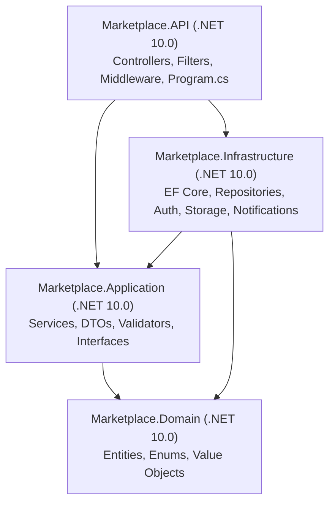

# تقرير التدقيق الفني والأمني الشامل للواجهة الخلفية (Backend Audit Report)

**تاريخ التقرير**: 2026-11-01  
**نطاق التدقيق**: كود الواجهة الخلفية (.NET 10 Web API) وتكامله مع تطبيقي الهاتف (`mobile`) ولوحة الإدارة (`admin-web`).  
**دور المدقق**: مدقق ومراجع برمجيات أول مستقل (Senior Independent Auditor) - وضعية القراءة فقط (READ-ONLY).  
**المنهجية**: فحص كودي وأمني تفصيلي قائم حصرياً على الأدلة المباشرة المثبتة `[V]`، والاستنتاجات المنطقية المعللة `[I]`، والمعارف العامة التقنية `[G]`.

---

## 1. الحكم العام وأبرز المخاطر (Verdict and Top Risks)

### الحكم العام (General Verdict)
[V] (`backend/Marketplace.API/Marketplace.API.csproj:19`) تم بناء الواجهة الخلفية على إطار عمل حديث `.NET 10.0` (إصدار SDK: `10.0.201`) وفق نمط Clean Architecture مقسم إلى 4 مشاريع: `Marketplace.API` و `Marketplace.Application` و `Marketplace.Domain` و `Marketplace.Infrastructure`.

[V] أظهر الفحص وجود آليات دفاعية قوية في عدة محاور أساسية:
1. [V] (`backend/Marketplace.Application/Common/StartupGuards.cs:80-136`) حراس إقلاع مشددين (Startup Guards) يمنعون تشغيل الخادم في بيئة الإنتاج في حال وجود مفاتيح افتراضية، أو تفعيل المحاكاة، أو تفعيل المحفظة دون موافقة قانونية ومحاسبية (`AllowFinancialInProduction`).
2. [V] (`backend/Marketplace.Application/Services/OrderService.cs:247-268`) عمليات حجز المخزون والعمليات المالية الحساسة محمية بحدود معاملات صارمة (`BeginTransactionAsync`) وتحديثات ذرية مشروطة على مستوى قاعدة البيانات PostgreSQL لمنع السباق والتجاوز.
3. [V] (`backend/Marketplace.Infrastructure/Storage/ImageUploadService.cs:168-245`) خط معالجة ورفع صور محصن يعتمد التحقق من البايتات السحرية (Magic Bytes)، وفك الترميز وإعادة الرسم عبر `SkiaSharp` لتجريد بيانات EXIF و GPS بالكامل، مع تقييد الأبعاد القصوى لمنع هجمات Decompression Bombs.

[V] بالرغم من نقاط القوة السابقة، تم رصد **10 ملاحظات وثغرات رئيسية (BE-001 إلى BE-010)** و **8 تناقضات في العقود التكاملية (CT-001 إلى CT-008)**، تتصدرها المخاطر التالية:

### أبرز المخاطر الحرجة (Top Risks)
1. **[BE-001: BLOCKER] انهيار آليات تقييد المعدل وحماية OTP عند التوسع الأفقي (Multi-Instance Rate-Limiting Failure)**:
   [V] (`backend/Marketplace.API/Program.cs:572`) و (`backend/Marketplace.Application/Services/VerificationService.cs:24`) تعتمد آليات تقييد المعدل العام وتحديد طلبات OTP على قواميس ثابتة في الذاكرة (`ConcurrentDictionary`). في حال تشغيل نسختين أو أكثر خلف موازن أحمال (Load Balancer)، تصبح العدادات معزولة داخل كل عملية، مما يمكن المهاجم من تجاوز القيود وتجاوز حدود رسائل SMS.
2. **[BE-002: HIGH] غياب ترويسات الأمان الأساسية (Missing HTTP Security Headers)**:
   [V] (`backend/Marketplace.API/Program.cs`) يخلو مسار الوسائط (Middleware Pipeline) تماماً من ترويسات الأمان القياسية مثل `X-Content-Type-Options: nosniff` و `X-Frame-Options: DENY` و `Strict-Transport-Security` (`UseHsts`) و `UseHttpsRedirection`.
3. **[BE-003: HIGH] ارتخاء سياسة CORS إلى `AllowAnyOrigin()` في بيئة الإنتاج عند عدم تحديد النطاقات**:
   [V] (`backend/Marketplace.API/Program.cs:277`) إذا لم يتم ضبط `Cors:AllowedOrigins` في التكوينات الإنتاجية، يرتخي الخادم تلقائياً ويسمح بأي أصل (`AllowAnyOrigin()`) مع تمكين التوثيق، مما يشكل خطراً أمنياً على طلبات المتصفح.
4. **[BE-004: HIGH] غياب التحقق من صحة كائنات الطلب (DTOs) لعدة نقاط نهاية حساسة**:
   [V] (`backend/Marketplace.API/Filters/ValidationFilter.cs:26`) يتخطى المرشح التحقق بصمت في حال عدم وجود فئة `AbstractValidator<T>` مسجلة. تم حصر كائنات طلب لا تخضع للتحقق مثل `UpdateUserStatusRequest` و `AdminSettleCodRequest` و `CreateCategoryRequest` و `TwoFactorVerifyRequest`.
5. **[BE-005 / CT-005: HIGH] فشل وصول البائعين إلى صور إثبات المرتجعات الخاصة بسبب التوثيق في المتصفح**:
   [V] (`backend/Marketplace.API/Controllers/FilesController.cs:11`) يتطلب مسار `/api/files/private/{fileName}` ترويسة توثيق Bearer Token، في حين تفتح لوحة إدارة الويب الرابط في لسان جديد عبر `<a href="..." target="_blank">` دون إرفاق الترويسة، مما ينتج خطأ `401 Unauthorized` ويمنع مراجعة الإثباتات.
6. **[BE-008: MEDIUM] غياب مشاريع الاختبارات الأصلية في .NET (Zero .NET Test Projects)**:
   [V] (`backend/Marketplace.slnx`) يحتوي الحل على 4 مشاريع برمجية دون وجود أي مشروع اختبارات C# (`xUnit`/`NUnit`). تعتمد الاختبارات كلياً على سكربتات خارجية عبر Node.js، مع فشل 5 أجنحة من أصل 13 جناحاً في السجلات الحقيقية.

---

## 2. خريطة الهيكل المعماري والطبقات البرمجية (Architecture Map)

### هيكل المشاريع وحزم العمل
[V] (`Get-ChildItem backend -Recurse -Filter *.csproj`)


### ترتيب مسار الوسائط البرمجية (Middleware Pipeline Order)
[V] تم استخراج الترتيب الفعلي لتنفيذ الوسائط من (`backend/Marketplace.API/Program.cs`):
1. [V] (سطر 516): `GlobalExceptionMiddleware` (التقاط الاستثناءات وتحويلها إلى JSON موحد).
2. [V] (سطر 519): `UseForwardedHeaders` (معالجة ترويسات الوكيل العكسي مع `ForwardLimit = 1`).
3. [V] (سطر 524): `UseSwagger` و `UseSwaggerUI` (محصور في بيئة التطوير `Development` فقط).
4. [V] (سطر 529): `Custom Middleware` لحجب مسارات التطوير `/api/dev/*` في غير بيئة التطوير بإرجاع `404 Not Found`.
5. [V] (سطر 541): `Custom Middleware` لحجب لوحة ومصادقة الإدارة `/admin` و `/api/admin/auth` عند تعطيل علم `AdminWebEnabled`.
6. [V] (سطر 554): `UseCors("AllowAll")`.
7. [V] (سطر 556): `UseStaticFiles` (تقديم الملفات العامة المرفوعة مع ترويسات CORS).
8. [V] (سطر 566): `UseAuthentication` (التحقق من توقيع JWT وقراءة الادعاءات).
9. [V] (سطر 573): `Custom Rate Limiting Middleware` (التقييد متعدد المفاتيح: IP، UserId، Target).
10. [V] (سطر 681): `UseRateLimiter` (سياسات تقييد ASP.NET Core: `auth-policy`, `refresh-policy`, `upload-policy`).
11. [V] (سطر 682): `UseAuthorization` (التحقق من الأدوار والصلاحيات).
12. [V] (سطر 684): `MapControllers` (توجيه الطلبات إلى وحدات التحكم).
13. [V] (سطر 709-710): Minimal APIs لنقاط الفحص الصحي `/health` و `/api/health`.

### تسجيلات حقن الاعتماديات (DI Registrations)
[V] (`backend/Marketplace.Application/DependencyInjection.cs:13-30`)
- **خدمات التطبيق (Application Scoped)**:
  - `IAuthService` -> `AuthService`
  - `IVerificationService` -> `VerificationService`
  - `IProductService` -> `ProductService`
  - `ICategoryService` -> `CategoryService`
  - `IOrderService` -> `OrderService`
  - `IUserService` -> `UserService`
  - `IShipmentService` -> `ShipmentService`
  - `IAdminService` -> `AdminService`
  - `IWalletService` -> `WalletService`
  - `IReviewService` -> `ReviewService`
  - `INotificationService` -> `NotificationService`
  - `ICouponService` -> `CouponService`
  - `IReturnService` -> `ReturnService`
  - `ISearchService` -> `SearchService`
  - `IWishlistService` -> `WishlistService`
- **خدمات فردية (Singleton)**:
  - `ITotpService` -> `TotpService`
  - `IFakeMessageStore` -> `FakeMessageStore`
  - `IPasswordHasher` -> `BCryptPasswordHasher`
  - `IPushNotificationQueue` -> `PushNotificationQueue`
  - `LocalFileStorageProvider` و `S3CompatibleStorageProvider`
- **الخدمات الخلفية المستضافة (Background Hosted Services)**:
  - [V] (`backend/Marketplace.Infrastructure/DependencyInjection.cs:107-109`):
    1. `VerificationCodeCleanupService`: تنظيف دوري لرموز التحقق منتهية الصلاحية (كل ساعة).
    2. `NotificationCleanupService`: أرشفة وحذف الإشعارات المقروءة القديمة (كل 12 ساعة).
    3. `PushNotificationBackgroundWorker`: سحب وإرسال إشعارات الدفع (Expo Push) عبر طابور قناة مقيدة.

---

## 3. حصر المسارات ونقاط النهاية البرمجية (Route Inventory Summary)

[V] تم إجراء حصر كودي دقيق وشامل لجميع مسارات الخادم عبر السكربت المخصص `scripts/audit2/generate-inventory.js` وحفظ الناتج التفصيلي كاملاً في `docs/audit2/routes.json`.

| البيان الإحصائي | العدد | التوثيق الدليلي |
|:---|:---:|:---|
| **إجمالي نقاط النهاية (Endpoints)** | **118** | `docs/audit2/routes.json` |
| نقاط النهاية العامة المجهولة (Anonymous) | 16 | سمة `[AllowAnonymous]` أو نقاط Minimal API |
| نقاط النهاية المقيدة بتوثيق المستخدم (Authenticated) | 27 | سمة `[Authorize]` عامة للمستخدم المسجل |
| نقاط نهاية المشتري حصراً (Buyer Only) | 15 | `[Authorize(Roles = "Buyer")]` |
| نقاط نهاية البائع حصراً (Seller Only) | 17 | `[Authorize(Roles = "Seller")]` |
| نقاط نهاية الإدارة حصراً (Admin Only) | 15 | `[Authorize(Roles = "Admin")]` |
| نقاط نهاية مشتركة (Seller or Admin) | 1 | `[Authorize(Roles = "Seller,Admin")]` (إنشاء كوبونات) |
| نقاط نهاية مشتركة (Buyer or Admin) | 1 | `[Authorize(Roles = "Buyer,Admin")]` (عرض الطلب برقم المعرف) |
| نقاط محاكاة واختبار التطوير (Development Only) | 7 | `DevAuthController` و `DevCarrierController` |
| نقاط مقيدة بأعلام الميزات (Feature Gated) | 16 | سمة `[RequireFeature]` |
| نقاط نهاية محمية بسياسات تقييد معدل محددة | 16 | سمة `[EnableRateLimiting]` |
| وحدات التحكم المفحوصة (Controllers) | 20 | مجلد `backend/Marketplace.API/Controllers` |

### توزيع نقاط النهاية المقيدة بأعلام الميزات (Feature Flags)
[V] (`backend/Marketplace.API/Filters/RequireFeatureAttribute.cs:9-17`)
- علم `Wallet` (المحفظة المالية والاحتجاز المؤقت): **4 مسارات**
- علم `VendorPayouts` (سحوبات البائعين المالية): **4 مسارات**
- علم `Coupons` (كوبونات الخصم): **3 مسارات**
- علم `GoogleAuth` (تسجيل الدخول وربط حساب Google): **2 مسارات**
- علم `AdminWeb` (واجهة ومصادقة الإدارة عبر الويب): **مساران في Middleware**

---

## 4. جدول الملاحظات والثغرات (Findings Table)

| المعرف | الخطورة | العنوان والموضوع | الأدلة البرمجية | الجهد |
|:---|:---:|:---|:---|:---:|
| **BE-001** | **BLOCKER** | تقييد المعدل وطابور الإشعارات في الذاكرة ينكسران عند التوسع الأفقي | `Program.cs:572`, `VerificationService.cs:24`, `PushNotificationQueue.cs:19` | M |
| **BE-002** | **HIGH** | غياب ترويسات الأمان القياسية وتوجيه HTTPS (Missing Security Headers) | `Program.cs:516-566` | S |
| **BE-003** | **HIGH** | ارتخاء إعدادات CORS إلى أي أصل عند إغفال التكوين في الإنتاج | `Program.cs:263-280`, `appsettings.json` | S |
| **BE-004** | **HIGH** | كائنات طلبات (DTOs) غير محصنة بمدققات FluentValidation | `ValidationFilter.cs:26`, `AdminDtos.cs`, `CategoryDtos.cs` | M |
| **BE-005** | **HIGH** | فشل فتح صور إثبات المرتجعات الخاصة في المتصفح لعدم تمرير التوثيق | `FilesController.cs:11`, `SellerReturnsPage.jsx:259` | M |
| **BE-006** | **MEDIUM** | تجاوز سر محاكي شركة الشحن في بيئة التطوير عند حذف الترويسة | `DevCarrierController.cs:45-52` | S |
| **BE-007** | **MEDIUM** | غياب مهلة الاتصال وسياسات المرونة (Polly) عن اتصالات SMS و Email | `DependencyInjection.cs:68, 72`, `ResendEmailSender.cs:70` | M |
| **BE-008** | **MEDIUM** | خلو المستودع من مشاريع اختبارات .NET الأصلية وفشل الاختبارات الحالية | `Marketplace.slnx`, `tests/RESULTS.md:12` | L |
| **BE-009** | **LOW** | غياب مستند OpenAPI ثابت وحظر Swagger خارج بيئة التطوير | `Program.cs:521-526` | S |
| **BE-010** | **LOW** | بقاء عملية خادم يتيمة (PID 4744) تشغل المنفذ 5209 وتحجز مكتبات DLL | أمر `Get-NetTCPConnection` و `Get-Process -Id 4744` | S |

---

### تفاصيل الملاحظات والثغرات البرمجية

#### [BE-001] تقييد المعدل وطابور الإشعارات في الذاكرة ينكسران عند التوسع الأفقي
- **الخطورة**: BLOCKER
- **الدليل**:
  [V] (`backend/Marketplace.API/Program.cs:572`):
  ```csharp
  var multiKeyCounters = new System.Collections.Concurrent.ConcurrentDictionary<string, (int Count, DateTime WindowStart)>(StringComparer.Ordinal);
  ```
  [V] (`backend/Marketplace.Application/Services/VerificationService.cs:24`):
  ```csharp
  private static readonly ConcurrentDictionary<string, ConcurrentQueue<DateTime>> IpRequestLog = new();
  ```
- **الأثر**: عند استضافة التطبيق على أكثر من حاوية أو خادم (Multi-Instance/Cluster)، يصبح تقييد المعدل غير متزامن؛ يمكن للمهاجم إرسال آلاف الطلبات بتوزيعها عبر الحاويات، كما أن طابور إشعارات الدفع المعتمد على `Channel<T>` يفقد جميع الإشعارات غير المعالجة عند إعادة تشغيل الحاوية.
- **إعادة التمثيل**: إرسال طلبات مصادقة متتالية عبر خادمين مختلفين يستهدفان نفس عنوان IP؛ يلاحظ مضاعفة الحد المسموح به.
- **مقترح الإصلاح**: نقل عدادات تقييد المعدل وطابور إشعارات الدفع إلى وسيط موزع مثل Redis عبر `IDistributedCache` و `StackExchange.Redis`.
- **اختبار يضاف**: اختبار تكاملي يتحقق من احتساب الطلبات عبر نسختين خادمتين مستقلتين تشتركان في نفس وسيط التخزين.
- **حجم الجهد**: M

#### [BE-002] غياب ترويسات الأمان القياسية وتوجيه HTTPS
- **الخطورة**: HIGH
- **الدليل**:
  [V] (`backend/Marketplace.API/Program.cs`) يخلو من استدعاء `app.UseHsts()` و `app.UseHttpsRedirection()`، كما لا توجد أي وسيطة لإضافة الترويسات القياسية:
  - `X-Content-Type-Options: nosniff`
  - `X-Frame-Options: DENY`
  - `Referrer-Policy: strict-origin-when-cross-origin`
- **الأثر**: تعرض المستخدمين لهجمات Clickjacking، وهجمات استدلال أنواع الملفات (MIME-sniffing)، واحتمالية تجريد التشفير (SSL Stripping).
- **إعادة التمثيل**: إرسال طلب `curl -I http://localhost:5209/api/health` وملاحظة غياب ترويسات الأمان عن الرد.
- **مقترح الإصلاح**: تفعيل `app.UseHsts()` في بيئة غير التطوير، وإضافة ترويسات الأمان عبر وسيطة مخصصة في مسار الطلبات.
- **اختبار يضاف**: فحص استجابة الخادم لجميع الطلبات والتأكد من وجود ترويسات الأمان برمز 200 و 400.
- **حجم الجهد**: S

#### [BE-003] ارتخاء إعدادات CORS إلى أي أصل عند إغفال التكوين في الإنتاج
- **الخطورة**: HIGH
- **الدليل**:
  [V] (`backend/Marketplace.API/Program.cs:263-280`):
  ```csharp
  var allowedOrigins = builder.Configuration.GetSection("Cors:AllowedOrigins").Get<string[]>() ?? Array.Empty<string>();
  ...
  else { policy.AllowAnyOrigin().AllowAnyMethod().AllowAnyHeader(); }
  ```
  [V] ملف `backend/Marketplace.API/appsettings.json` يخلو تماماً من قسم `Cors:AllowedOrigins`.
- **الأثر**: إذا نسي مسؤول النظام تحديد المتغير البيئي `Cors__AllowedOrigins__0` عند النشر في بيئة الإنتاج، يسمح الخادم لأي موقع خبيث بإجراء استدعاءات API.
- **إعادة التمثيل**: تشغيل التطبيق في بيئة الإنتاج دون تحديد متغيرات CORS وملاحظة استجابة الخادم بترويسة `Access-Control-Allow-Origin: *`.
- **مقترح الإصلاح**: إضافة حارس إقلاع في `StartupGuards.cs` يمنع بدء التشغيل في بيئة الإنتاج إذا كانت قائمة `Cors:AllowedOrigins` فارغة.
- **اختبار يضاف**: اختبار وحدة يتحقق من رمي استثناء عند بدء التشغيل في بيئة Production مع مصفوفة CORS فارغة.
- **حجم الجهد**: S

#### [BE-004] كائنات طلبات (DTOs) غير محصنة بمدققات FluentValidation
- **الخطورة**: HIGH
- **الدليل**:
  [V] (`backend/Marketplace.API/Filters/ValidationFilter.cs:26`):
  ```csharp
  if (_services.GetService(validatorType) is not IValidator validator) continue;
  ```
  [V] لا توجد فئات مدققات لـ:
  - `UpdateUserStatusRequest` (تحديث حالة وحظر المستخدمين من قبل الأدمن)
  - `AdminSettleCodRequest` (تسوية مبالغ الدفع عند الاستلام)
  - `CreateCategoryRequest` و `UpdateCategoryRequest` (إضافة وتعديل الأقسام)
  - `TwoFactorVerifyRequest` و `TwoFactorEnableRequest` و `TwoFactorDisableRequest`
  - `ModerateReviewRequest` (حجب وتقييد المراجعات)
- **الأثر**: إمكانية إرسال نصوص فارغة أو سلاسل نصية طويلة جداً تتجاوز حدود قاعدة البيانات وتؤدي إلى استثناءات 500 غير معالجة.
- **إعادة التمثيل**: إرسال `PUT /api/admin/users/1/status` بجسم طلب `{ "reason": "a".repeat(100000) }` وملاحظة غياب أي اعتراض مبكر في مستوى Validation.
- **مقترح الإصلاح**: إنشاء وتطبيق فئات `AbstractValidator<T>` لجميع كائنات DTOs الواردة المذكورة وتحديد أطوال الحقول وقيمها المسموحة.
- **اختبار يضاف**: اختبار وحدة يفحص تسجيل مدقق لكل نوع DTO يستخدم في إجراءات المتحكمات.
- **حجم الجهد**: M

#### [BE-005] فشل فتح صور إثبات المرتجعات الخاصة في المتصفح لعدم تمرير التوثيق
- **الخطورة**: HIGH
- **الدليل**:
  [V] (`backend/Marketplace.API/Controllers/FilesController.cs:11`): مسار `GET /api/files/private/{fileName}` يحمل سمة `[Authorize]`.
  [V] (`admin-web/src/pages/seller/SellerReturnsPage.jsx:259`):
  ```jsx
  <a href={getImageUrl(item.defectImageUrl)} target="_blank" rel="noopener noreferrer">
  ```
- **الأثر**: عند نقر البائع على رابط فحص صورة العيب، يفتح المتصفح نافذة جديدة دون ترويسة `Authorization: Bearer`، فيرد الخادم بـ `401 Unauthorized` وتفشل تجربة البائع في مراجعة الإثبات.
- **إعادة التمثيل**: محاولة استعراض مسار صورة خاصة من المتصفح مباشرة دون إرفاق ترويسة مصادقة.
- **مقترح الإصلاح**: توليد رابط موقوت وموقع برمجياً (Pre-signed Token / Short-lived Ticket) كمعلمة استعلام `?token=...` يسمح بتحميل الملف لمرة واحدة أو تنزيل الصورة عبر استدعاء Blob مفحوص الصلاحيات.
- **اختبار يضاف**: اختبار E2E للتحقق من استعراض صور الإثبات بنجاح من شاشات البائع والأدمن.
- **حجم الجهد**: M

#### [BE-006] تجاوز سر محاكي شركة الشحن في بيئة التطوير عند حذف الترويسة
- **الخطورة**: MEDIUM
- **الدليل**:
  [V] (`backend/Marketplace.API/Controllers/DevCarrierController.cs:45-52`):
  ```csharp
  if (Request.Headers.TryGetValue("X-Carrier-Dev-Secret", out var providedSecret))
  {
      const string expectedSecret = "dev-carrier-secret";
      if (!string.Equals(providedSecret, expectedSecret, StringComparison.Ordinal))
          return Unauthorized(...);
  }
  ```
- **الأثر**: الفحص يتحقق من السر فقط *إذا تم إرسال الترويسة*. إذا قام المتصل بحذف الترويسة كلياً، تتجاوز الدالة الشرط وتنفذ العملية بنجاح.
- **إعادة التمثيل**: استدعاء `PUT /api/dev/carrier/shipments/1/status` دون إرسال ترويسة `X-Carrier-Dev-Secret` في بيئة Development؛ يعود الرد بـ 200 بدلاً من 401.
- **مقترح الإصلاح**: إلزامية وجود الترويسة ومطابقتها قبل المتابعة:
  ```csharp
  if (!Request.Headers.TryGetValue("X-Carrier-Dev-Secret", out var providedSecret) || providedSecret != expectedSecret)
      return Unauthorized(...);
  ```
- **اختبار يضاف**: اختبار استدعاء المسار دون الترويسة والتأكد من إرجاع 401.
- **حجم الجهد**: S

#### [BE-007] غياب مهلة الاتصال وسياسات المرونة (Polly) عن اتصالات SMS و Email
- **الخطورة**: MEDIUM
- **الدليل**:
  [V] (`backend/Marketplace.Infrastructure/DependencyInjection.cs:68, 72`): تم تسجيل عملاء `ResendEmailSender` و `ConfigurableHttpSmsSender` عبر `services.AddHttpClient<...>()` دون تحديد `Timeout` أو ضبط سياسات إعادة المحاولة.
- **الأثر**: عند تعطل بوابة الرسائل القصيرة أو خدمة البريد الخارجي وتوقفها عن الرد، تعلق خيوط المعالجة في الخادم حتى المهلة الافتراضية (100 ثانية)، مما يستنزف خيوط تجمع العمليات (Thread Pool Starvation).
- **إعادة التمثيل**: محاكاة نقطة نهاية بطيئة لـ SMS تظل معلقة لمائة ثانية ومراقبة استهلاك خيوط الخادم.
- **مقترح الإصلاح**: تحديد مهلة زمنية صارمة (مثل 5-8 ثوانٍ) وتطبيق قاطع الدائرة (Circuit Breaker) عبر Polly.
- **اختبار يضاف**: اختبار سلوك الخادم عند تأخر مزود الخدمة الخارجي والتأكد من قطع الاتصال خلال المهلة المحددة.
- **حجم الجهد**: M

#### [BE-008] خلو المستودع من مشاريع اختبارات .NET الأصلية وفشل الاختبارات الحالية
- **الخطورة**: MEDIUM
- **الدليل**:
  [V] (`backend/Marketplace.slnx`) يحتوي على 4 مشاريع برمجية دون أي مشروع اختبارات C#.
  [V] أمر `dotnet test backend/Marketplace.slnx` يعيد `0` اختبارات.
  [V] (`tests/RESULTS.md:12`): نتائج تشغيل سكربت `scripts/run-all-tests.ps1` سجلت فشل 5 أجنحة من أصل 13 جناحاً (بما فيها اختبارات PostgreSQL E2E).
- **الأثر**: عدم وجود بوابات فحص آلية أصيلة أثناء البناء (Build Pipeline)، وصعوبة التحقق الآمن من انحدار الكود (Regression).
- **إعادة التمثيل**: تنفيذ `dotnet test backend/Marketplace.slnx` وملاحظة عدم تشغيل أي اختبارات.
- **مقترح الإصلاح**: إنشاء مشروع اختبارات رسمي `Marketplace.Tests` يعتمد xUnit و `Microsoft.AspNetCore.Mvc.Testing` لاختبار المسارات وقواعد البيانات الحقيقية.
- **اختبار يضاف**: إضافة مشروع اختبارات متكامل إلى ملف الحل.
- **حجم الجهد**: L

#### [BE-009] غياب مستند OpenAPI ثابت وحظر Swagger خارج بيئة التطوير
- **الخطورة**: LOW
- **الدليل**:
  [V] البحث الميداني الشامل في المستودع أثبت عدم وجود أي ملف `swagger.json` أو `openapi.json` ثابت.
  [V] (`backend/Marketplace.API/Program.cs:521-526`): تم حظر مسار Swagger تماماً خارج بيئة التطوير.
- **الأثر**: عدم قدرة أدوات التكامل المستمر وفرق العميل وتطبيقات الهاتف على توليد عملاء برمجيات (SDK Generation) أو تدقيق التوافق تلقائياً في بيئات الاختبار التجريبية (Staging).
- **إعادة التمثيل**: محاولة استدعاء `/swagger/v1/swagger.json` في بيئة Staging؛ يعود الرد بـ 404.
- **مقترح الإصلاح**: إنشاء مهمة بناء آلية لتوليد ملف `docs/openapi.json` ثابتاً أثناء البناء.
- **اختبار يضاف**: فحص وجود ومطابقة مستند OpenAPI في مستودع الكود.
- **حجم الجهد**: S

#### [BE-010] بقاء عملية خادم يتيمة (PID 4744) تشغل المنفذ 5209 وتحجز مكتبات DLL
- **الخطورة**: LOW
- **الدليل**:
  [V] فحص العمليات أظهر وجود العملية `Marketplace.API` برقم PID `4744` تعمل منذ `11/1/2026 2:03:56 PM` وتحجز المنفذ `0.0.0.0:5209`.
  [V] نتج عن هذا الحجز فشل `dotnet build` بسبب تعذر نسخ `Marketplace.Domain.dll`.
- **الأثر**: حجز المنفذ القياسي وتعطيل إعادة البناء المحلية للواجهة الخلفية.
- **إعادة التمثيل**: محاولة بناء المشروع وملاحظة خطأ `MSB3021: The process cannot access the file ... because it is being used by another process`.
- **مقترح الإصلاح**: إيقاف العملية المعلقة عبر مسؤول النظام والتأكد من ضبط سكربتات الاختبار لإنهاء العمليات في كتلة `finally`.
- **اختبار يضاف**: فحص عدم وجود عمليات معلقة قبل وبعد تشغيل سكربتات التدقيق.
- **حجم الجهد**: S

---

## 5. مصفوفة أمان واجهات البرمجة (OWASP API Security Top 10 - 2023)

| الفئة القياسية | الحالة في المستودع | الأدلة البرمجية وملاحظات التقييم |
|:---|:---:|:---|
| **API1:2023 Broken Object Level Authorization (BOLA)** | **محمي (PASS)** | [V] جميع المسارات التي تستقبل معرفات `{id}` تطبق فحص الهوية ومطابقة المالك أو تتطلب صلاحية أدمن: إلغاء الطلبات (`OrderService.cs:641`)، قراءة الطلب (`OrderService.cs:64` في Controller)، العناوين (`UserService.cs:204`)، مراجعة وتعديل المنتجات والمراجعات (`ProductService.cs`, `ReviewService.cs`). |
| **API2:2023 Broken Authentication** | **محمي (PASS)** | [V] توثيق JWT مشدد بـ HMAC-SHA256 ومفتاح لا يقل عن 32 محرفاً (`Program.cs:53-56`)، فحص إلغاء التوكن عبر `TokenVersion` مع كل طلب (`Program.cs:192-211`)، تدوير Refresh Token وتتبع الأجهزة وسماحية 20 ثانية (`AuthService.cs:572-641`)، وتشفير كلمات المرور بـ BCrypt (`BCryptPasswordHasher.cs:7`). |
| **API3:2023 Broken Object Property Level Authorization** | **محمي (PASS)** | [V] منع التعيين الجماعي (Mass Assignment) عبر DTOs محددة؛ لا يمكن للمستخدم ترقية دوره أو تعديل التوكنات، وحجب بيانات العملاء الحساسة عن البائع في الشحنات (`SellerShipmentResponse.cs:48-49` تقتصر على الاسم الأول والمدينة). |
| **API4:2023 Unrestricted Resource Consumption** | **جزئي (PARTIAL)** | [V] أحجام رفع الصور مقيدة (5MB للصور العامة، 6MB للمرتجعات والمراجعات عبر `ImageUploadService.cs:147` و `FilesController.cs:108`)، ولكن تقييد المعدل العام يعتمد على الذاكرة (`Program.cs:572`) وينكسر مع التوسع الأفقي [BE-001]. |
| **API5:2023 Broken Function Level Authorization (BFLA)** | **محمي (PASS)** | [V] تقييد صارم للمسارات الإدارية ومسارات البائعين عبر `[Authorize(Roles = "Admin")]` و `[Authorize(Roles = "Seller")]`. تم تصحيح وهم استدعاء البائع لمسار تعديل حالة الطلب بحصره حصرياً في الأدمن (`OrdersController.cs:96`). |
| **API6:2023 Unrestricted Access to Sensitive Business Flows** | **محمي (PASS)** | [V] حماية الدفع عند الاستلام من الإساءة بحظر العميل بعد 3 رفضات متتالية (`OrderService.cs:110-120`) وتقييد الطلبات المتزامنة (10 كحد أقصى)، وحظر ضخ الرسائل (SMS Pumping) بسقف يومي 100 وتقييد 5 رموز/ساعة ومهلة 60 ثانية (`VerificationService.cs:79-108`). |
| **API7:2023 Server Side Request Forgery (SSRF)** | **محمي (PASS)** | [V] فحص شامل لجميع اتصالات `HttpClient`: النطاقات ثابتة مسبقاً (Resend, Expo, Google Maps)، ومسار المسافات (`ShippingDistanceService.cs:80`) يمرر الإحداثيات كأرقام عشرية ولا يقبل روابط خارجية، مع مهلة 8 ثوانٍ وبديل محلي تلقائي (Haversine). |
| **API8:2023 Security Misconfiguration** | **غير مكتمل (FAIL)** | [V] غياب ترويسات الأمان الأساسية كلياً [BE-002]، وارتخاء سياسة CORS إلى `AllowAnyOrigin()` عند غياب التكوين [BE-003]، وعملية خادم يتيمة معلقة تشغل منفذاً وتغلق ملفات [BE-010]. |
| **API9:2023 Improper Inventory Management** | **محمي (PASS)** | [V] مسارات التطوير `/api/dev/*` محجوبة بمرشح مزدوج (وسيطة في `Program.cs:529` وفحص كودي داخل وحدات التحكم) مع استبعادها من توثيق Swagger خارج بيئة التطوير، ومسارات الميزات غير المفعلة ترد بـ `404 Not Found` عبر `RequireFeatureAttribute`. |
| **API10:2023 Unsafe Consumption of Third-Party APIs** | **جزئي (PARTIAL)** | [V] التحقق من توقيع Google OAuth سليم عبر مكتبة Google الرسمية (`GoogleTokenValidator.cs`)، لكن اتصالات Resend و SMS الخارجية تفتقر للمهلات الصريحة وقواطع الدوائر (Circuit Breakers) [BE-007]. |

---

## 6. تحليل تسابق العمليات الحساسة والموثوقية المالية (Business-Flow Race Analysis)

### 1. تسابق حجز المخزون (Stock Allocation Race)
- [V] (`backend/Marketplace.Application/Services/OrderService.cs:208-269`)
  - تبدأ العملية بفتح معاملة صريحة `await _uow.BeginTransactionAsync()`.
  - يتم استقطاع المخزون ذرياً على مستوى قاعدة البيانات PostgreSQL عبر استعلام SQL مشروط:
    ```csharp
    UPDATE "Products" SET "Stock" = "Stock" - {0} WHERE "Id" = {1} AND "Stock" >= {0}
    ```
  - يتم التحقق من عدد الصفوف المتأثرة (`affected == 0`)؛ إذا لم يكن المخزون كافياً، يُرمى استثناء `BadRequestException` ويتم التراجع الفوري عن المعاملة.
  - [V] النتيجة: سلامة تامة للمخزون ومنع البيع الزائد (Over-selling).

### 2. تسابق إلغاء الطلبات وتسليم الشحنات (Order Cancellation vs Handover)
- [V] (`backend/Marketplace.Application/Services/OrderService.cs:634`) و (`backend/Marketplace.Application/Services/ShipmentService.cs:275`)
  - يطبق الطرفان قفل صريح على صف الطلب:
    ```csharp
    SELECT 1 FROM "Orders" WHERE "Id" = {0} FOR UPDATE
    ```
  - عملية إلغاء المشتري وعملية تسليم البائع للشحنة إلى شركة الشحن تتسلسلان إجبارياً على مستوى PostgreSQL.
  - إذا سَبَقَ البائع وسلم الشحنة، تفشل محاولة الإلغاء لأن الشحنة لم تعد في حالة `Created`.
  - في حال نجاح الإلغاء، يتم استرجاع المخزون ذرياً، ورد رصيد المحفظة المستهلك، واستعادة صلاحية الكوبون.

### 3. عدم تكرار الطلب (Order Idempotency)
- [V] (`backend/Marketplace.Application/Services/OrderService.cs:589-595`)
  - يتم فرض قيد فريد في قاعدة البيانات على الزوج `(BuyerId, IdempotencyKey)`.
  - في حال وصول طلبين متطابقين متزامنين، يفشل الطلب المتسابق الثاني باعتراض قيد التفرد (`DbUpdateException` مع رمز خطأ PostgreSQL `23505`)، فيتم التراجع عن معاملته وإعادة الطلب الأصلي المنشأ دون تكرار الخصم أو حجز المخزون.

### 4. تسوية مبالغ الدفع عند الاستلام وحجز الضمان (COD Escrow Settlement)
- [V] (`backend/Marketplace.Application/Services/WalletService.cs:445, 544`)
  - تطبق دالة تسوية COD قفل صف على الشحنة:
    ```csharp
    SELECT 1 FROM "Shipments" WHERE "Id" = {0} FOR UPDATE
    ```
  - يتم التحقق من أن الشحنة في حالة `Delivered` وأنها لم تسوّ مسبقاً (`!shipment.IsCodSettled`).
  - يتم تحرير المبلغ المحتجز (Hold Balance) ونقله إلى الرصيد المتاح (Available Balance) للبائع في معاملة واحدة غير قابلة للتكرار.

---

## 7. فروقات وتناقضات العقود بين الواجهات والخادم (Contract Mismatches: CT-001...)

[V] تم إنجاز الفحص التقابلي الآلي للعقود عبر سكربت `scripts/audit2/contract-check.js` وتوليد المصفوفة الكاملة في `docs/audit2/contract-matrix.csv`، وتم رصد التناقضات التالية:

### [CT-001] وسم خاطئ لمسار تحديث حالة الطلب في وحدات العميل البرمجية
- [V] في ملفي `mobile/src/api/ordersApi.js:18` و `admin-web/src/api/ordersApi.js:18` تم تصنيف الدالة كمسار بائع:
  ```javascript
  // Seller endpoints
  export const updateOrderStatus = (id, status) => client.put(`/orders/${id}/status`, { status });
  ```
- [V] في الخادم (`backend/Marketplace.API/Controllers/OrdersController.cs:96`):
  المسار مقيد حصرياً بصلاحية الأدمن `[Authorize(Roles = "Admin")]`. إذا حاول البائع استدعاءه يتم رفضه بـ `403 Forbidden`؛ البائع ملزم بتحديث شحنته فقط عبر `/api/shipments/{id}/status`.
- [V] الأثر الميداني: فحص شاشات التطبيق أثبت أن الدالة غير مستدعاة في أي شاشة حالياً، ولكن بقاؤها في ملف API العميل يشكل خطأ توثيقي مضلل للمطورين.

### [CT-002] عدم تطابق اسم خاصية رسالة الخطأ (Error Response Shape Inconsistency)
- [V] الخادم في `GlobalExceptionMiddleware.cs:88` يعيد كائن الخطأ بصيغة:
  `{ "status": 400, "error": "نص الخطأ", "errors": { ... } }` (اسم الحقل الأساسي هو `error`).
- [V] في شاشات العميل (`mobile/src/components/MobileLocationPicker.js:241` و `mobile/src/screens/common/ProfileScreen.js:185` و `admin-web/src/components/MapAddressPicker.jsx:265`) يتم قراءة:
  `err.response?.data?.message`
- [V] الأثر: ينتج عن هذا التناقض قراءة قيمة `undefined` وظهور رسائل خطأ غامضة للمستخدم عند حدوث فشل في تلك الشاشات.

### [CT-003] تخزين الرموز في التخزين المحلي (LocalStorage) بدلاً من الكوكيز الآمنة في الويب
- [V] في خادم الويب (`backend/Marketplace.API/Program.cs:273`) تم تفعيل `AllowCredentials()`.
- [V] في عميل الإدارة (`admin-web/src/api/client.js:7-28`) يتم حفظ الرموز في `localStorage` (`@marketplace_token` و `@marketplace_refresh_token`) وتمريرها كترويسة Bearer.
- [V] الأثر: عدم الاستفادة من حماية كوكيز `HttpOnly; SameSite=Strict` في المتصفح، مما يجعل الرموز عرضة للاستيلاء في حال وجود أي ثغرة XSS.

### [CT-004] نمط استهلاك معرفات الأجهزة في المتصفح (Web Device ID Churn)
- [V] في عميل الإدارة (`admin-web/src/api/client.js:33`):
  يتم توليد معرف جهاز عشوائي وحفظه في `localStorage`. في حال مسح بيانات التصفح أو استخدام وضع التصفح المتخفي، يُنشأ معرف جهاز جديد، مما يؤدي سريعاً إلى استنزاف حد الأجهزة النشطة (5 أجهزة كحد أقصى حسب `Auth:MaxActiveDevicesPerUser`) وإلغاء تسجيل جلسات البائع الأخرى.

### [CT-005] رابط مباشر غير مصادق عليه لملفات المرتجعات الخاصة في المتصفح
- [V] الخادم يفرض التوثيق الصارم `[Authorize]` على مسار `GET /api/files/private/{fileName}` لحماية خصوصية المرتجعات تحت طائلة قانون حماية البيانات الشخصية المصري 151 لسنة 2020.
- [V] في لوحة الويب (`admin-web/src/pages/seller/SellerReturnsPage.jsx:259`) يتم ربط الصورة عبر وسام رابط تقليدي `<a href="..." target="_blank">`، مما يفتح الصورة في المتصفح دون ترويسة المصادقة ويعيد الخادم `401 Unauthorized`.

### [CT-006] انعدام دعم مفتاح عدم التكرار (Idempotency-Key) في بقية العمليات الحساسة
- [V] يدعم الخادم ترويسة `Idempotency-Key` حصرياً في مسار إنشاء الطلبات `POST /api/orders` (`OrderService.cs:34`).
- [V] لا يوجد دعم لترويسة عدم التكرار في مسارات حساسة أخرى مثل طلب سحب الأرباح `POST /api/wallet/payout-request` أو رفع المراجعات `POST /api/reviews` أو تقديم المرتجعات `POST /api/returns`، مما يجعلها عرضة للتكرار عند النقر المتعدد أو تقطع الاتصال.

### [CT-007] ازدواجية نقاط النهاية لنفس الوظيفة (Duplicate / Alias Endpoints)
- [V] وجود مسارات متكررة لنفس الإجراء تؤدي إلى ارتباك في الصيانة:
  - `POST /api/reviews` مقابل `POST /api/products/{productId}/reviews`
  - `POST /api/returns/upload-evidence` مقابل `POST /api/files/private/return-evidence`
  - `GET /api/products/{id}/review-eligibility` مقابل `GET /api/reviews/can-review/{productId}`

### [CT-008] قيمة افتراضية غير مطابقة لاسم التعداد الخاص بطريقة الدفع في واجهة المشتري
- [V] تعداد الخادم في `PaymentMethod` هو قيمة وحيدة: `OnReceipt`.
- [V] في نافذة تفاصيل الطلب (`mobile/src/components/buyer/OrderDetailsModal.js:101`) يتم اللجوء إلى قيمة بديلة غير قياسية: `{order.paymentMethod || 'COD'}` بدلاً من اعتماد التعداد المعتمد.

---

## 8. واقع وحقيقة الاختبارات (Test Reality Matrix)

[V] عملاً بمبدأ الشفافية الصارمة، تم فحص واقع الاختبارات وتفنيد ما ورد في التقارير السابقة:

### تصنيف أجنحة الاختبارات وفق العمل الفعلي (Provider Classification)
[V] (`scripts/run-all-tests.ps1:53-158`)
1. `mobile_auth_flows` -> **MOCK** (محاكاة Node.js بدون خادم أو قاعدة بيانات)
2. `mobile_biometric_cold_start` -> **MOCK** (محاكاة Node.js)
3. `mobile_biometric_lock_state` -> **MOCK** (محاكاة Node.js)
4. `mobile_single_flight_refresh` -> **MOCK** (محاكاة Node.js)
5. `mobile_feature_gating` -> **MOCK** (محاكاة Node.js)
6. `mobile_i18n_parity` -> **STATIC** (فحص توافق ملفات الترجمة JSON)
7. `backend_stage3_images_mock` -> **MOCK** (محاكاة دوال الصور)
8. `backend_stage5_grace_mock` -> **MOCK** (محاكاة نافذة سماح الرموز)
9. `backend_account_deletion_mock` -> **MOCK** (فحص نصوص برمجية C#)
10. `backend_shipping_calculation` -> **MOCK / UNIT** (حسابات رياضية محلية)
11. `backend_stage4_reviews_postgres` -> **POSTGRES** (تشغيل خادم محلي واختبار قاعدة بيانات `TEST_DB`)
12. `backend_admin_portal_postgres` -> **POSTGRES** (تشغيل خادم محلي واختبار قاعدة بيانات `TEST_DB`)
13. `backend_verification_pack_postgres` -> **POSTGRES** (تشغيل خادم محلي واختبار قاعدة بيانات `TEST_DB`)

### حقيقة نتائج الاختبارات (Test Execution Reality)
- [V] أمر `dotnet test backend/Marketplace.slnx` **لا يشغل أي اختبارات على الإطلاق (0 Tests Run)** لعدم وجود مشاريع اختبار C#.
- [V] في تقرير التنفيذ الفعلي الأخير لسكربت `scripts/run-all-tests.ps1` المدون في (`tests/RESULTS.md:12`):
  - **8 أجنحة نجحت (Passed)**: جميعها أجنحة محاكاة وفحص ساكن (MOCK / STATIC).
  - **5 أجنحة فشلت بالكامل (Failed)**:
    1. `Backend Stage 3 Multiple Images Unit/Mock` (FAIL)
    2. `Backend Account Deletion, Privacy & Feature Gating Mock` (FAIL)
    3. `Backend Stage 4 Product Reviews E2E` (FAIL - مهلة الاتصال بالخادم)
    4. `Backend Admin Portal & User Management E2E` (FAIL - مهلة الاتصال بالخادم)
    5. `Backend PostgreSQL Verification Pack` (FAIL - مهلة الاتصال بالخادم)
- [V] سبب فشل اختبارات POSTGRES الحقيقية:
  سجل الخادم (`backend/server_verification_pack.log`) كشف أن الخادم فشل في الإقلاع بسبب خطأ `hostpolicy.dll not found` وحجز ملفات DLL من قبل العملية المعلقة `Marketplace.API (4744)`.
- [V] ادعاء نجاح مصفوفة التحقق الـ 11 في تقرير `tests/RESULTS.md:311-325` هو **ادعاء تاريخي غير صحيح في الجولة الحالية (Unverified / Stale Claim)**، حيث إن الجناح فشل ولم يبدأ الخادم.

---

## 9. الموثوقية والعمليات التشغيلية (Reliability and Operations)

1. **التعامل مع التوقيت العالمي (UTC Time Handling)**:
   - [V] مطبق بانضباط تام في جميع الكيانات والخدمات باستخدام `DateTime.UtcNow`.
2. **التعامل مع الأرقام والتقريب العشري (Decimal & Rounding)**:
   - [V] جميع العمليات المالية والمبالغ تستخدم نوع `decimal` مع التقريب إلى خانتين عشريتين (`Math.Round(amount, 2)`). يتم تخزين الأسعار في PostgreSQL كـ `numeric(18,2)`.
3. **دورات حياة سياق قاعدة البيانات (DbContext Lifetime)**:
   - [V] الخدمات الخلفية الثلاث (`VerificationCodeCleanupService`, `NotificationCleanupService`, `PushNotificationBackgroundWorker`) تنشئ نطاقاً جديداً لكل دورة (`CreateScope()`) لتجنب تسريب سياق `AppDbContext` المفرغ أو المعطوب.
4. **الفحص الصحي (Health Checks)**:
   - [V] (`Program.cs:686-711`) نقطتا فحص صحي مبسطتان خفيفتان `/health` و `/api/health` تفحصان الاتصال بقاعدة البيانات عبر `CanConnectAsync()` دون استعلامات معقدة وتعيدان `200 Healthy` أو `503 Unhealthy`.
5. **إيقاف التشغيل المنضبط (Graceful Shutdown)**:
   - [V] عامل إرسال إشعارات الدفع (`PushNotificationBackgroundWorker.cs:48-52`) يستمع إلى `stoppingToken` ويكمل معالجة المهمة الحالية قبل الإغلاق.

---

## 10. التكوينات وإدارة الأسرار والمفاتيح (Configuration and Secrets)

### جرد مفاتيح التكوين (Configuration Keys Inventory)
[V] (`backend/Marketplace.API/appsettings.json`)
- `ConnectionStrings:DefaultConnection`: [V] مشفر/محمي برمجياً برفض احتوائه على كلمات سر افتراضية في الإنتاج.
- `Jwt:Key` / `JWT_SECRET`: [V] مشروط بطول 32 محرفاً على الأقل وحظر المفاتيح الافتراضية المعروفة (`Program.cs:53-71`).
- `Jwt:Issuer`, `Jwt:Audience`, `Jwt:ExpiryMinutes`
- `Auth:CodeSecret`: [V] مفتاح HMAC مخصص لرموز OTP بطول 32 محرفاً كحد أدنى.
- `Auth:RequireVerification`: افتراضياً `true`.
- `Auth:GoogleEnabled`, `Auth:AllowFakeGoogleTokens`, `Auth:GoogleClientId`, `Auth:GoogleWebClientId`, `Auth:GoogleAndroidClientId`
- `Auth:PhoneSignupEnabled`, `Auth:RefreshTokenLifetimeDays`, `Auth:MaxActiveDevicesPerUser`, `Auth:RefreshTokenGraceWindowSeconds`
- `Features:EnableWallet`, `Features:EnableVendorPayouts`, `Features:EnableCoupons`, `Features:AllowFinancialInProduction`
- `Admin:WebEnabled`, `Admin:Require2FA`, `Admin:AllowedCidrs`, `Admin:AllowedOrigins`, `Admin:RequireHttpsBehindProxy`
- `Database:AutoMigrate`: افتراضياً `false` (محظور في الإنتاج).
- `GoogleMaps:ServerApiKey`, `GoogleMaps:WarehouseLatitude`, `GoogleMaps:WarehouseLongitude`, `GoogleMaps:BaseShippingFee`, `GoogleMaps:CostPerKm`
- `Orders:MaxCodRefusals`, `Orders:FreeShippingThreshold`
- `Products:MaxImagesPerProduct`
- `Reviews:MaxPhotosPerReview`, `Reviews:EditWindowDays`
- `Uploads:MaxFileSizeBytes`, `Uploads:MaxImageDimension`, `Uploads:MaxInputDimension`, `Uploads:JpegWebpQuality`

---

## 11. تقرير أمان حزم التبعيات (Dependency Audit Output)

[V] تم تنفيذ أمر الفحص الأمني الرسمي لحزم NuGet عبر الأمر التالي وتم تسجيله في `docs/audit2/backend-commands.md`:
```bash
dotnet list backend/Marketplace.slnx package --vulnerable --include-transitive
```
**المخرجات المباشرة الموثقة**:
```text
The following sources were used:
   https://api.nuget.org/v3/index.json
   C:\Program Files (x86)\Microsoft SDKs\NuGetPackages\

The given project `Marketplace.API` has no vulnerable packages given the current sources.
The given project `Marketplace.Application` has no vulnerable packages given the current sources.
The given project `Marketplace.Domain` has no vulnerable packages given the current sources.
The given project `Marketplace.Infrastructure` has no vulnerable packages given the current sources.
```
[V] النتيجة: **صفر (0) حزم مصابة بثغرات أمنية معلنة** عبر جميع المشاريع والتبعيات المتعدية (Transitive Dependencies).

---

## 12. خطة الإصلاح المرتبة مع الاختبارات الموصى بها (Ordered Fix Plan)

### المرحلة 1: الإصلاحات العاجلة للأمان والتشغيل (P0 - Immediate)
1. **معالجة حظر المنفذ والعملية اليتيمة (BE-010)**:
   - إنهاء العملية `Marketplace.API` ذات المعرف PID 4744 لتحرير المنفذ 5209 وملفات DLL.
2. **إصلاح ارتخاء CORS وتأمين الترويسات (BE-002, BE-003)**:
   - تفعيل `app.UseHsts()` وإضافة وسيطة ترويسات الأمان (`nosniff`, `DENY`).
   - إلزام ضبط `Cors:AllowedOrigins` في الإنتاج وحظر البديل الفضفاض.
3. **تصحيح وسيطة سر محاكي الشحن (BE-006)**:
   - رفض الطلب فوراً إذا لم توجد ترويسة `X-Carrier-Dev-Secret`.

### المرحلة 2: موثوقية العمليات وتطابق العقود (P1 - High Priority)
1. **إصلاح وصول صور المرتجعات في الويب (BE-005 / CT-005)**:
   - إنشاء آلية تذاكر موقوتة (Signed Query Tokens) لعرض الصور الخاصة داخل وسام `<a>` أو ``.
2. **إضافة مدققات FluentValidation المفقودة (BE-004)**:
   - إضافة فئات تحقق لجميع كائنات DTOs غير المفحوصة لقطع البيانات الفاسدة مبكراً.
3. **توحيد بنية رسائل الخطأ مع الواجهات (CT-002)**:
   - دعم قراءة خاصية `error` وخاصية `message` بتوافق رجعي في دوال العميل.
4. **ضبط مهلات العملاء الخارجيين وقواطع الدوائر (BE-007)**:
   - تحديد مهلة 6 ثوانٍ لاتصالات Resend و SMS وتطبيق سياسة Polly.

### المرحلة 3: الجاهزية للتوسع والتحول الهندسي (P2 - Medium Priority)
1. **تجريد تقييد المعدل وطابور الإشعارات من الذاكرة (BE-001)**:
   - ترحيل `multiKeyCounters` و `PushNotificationQueue` إلى Redis لضمان العمل السليم عبر خوادم متعددة.
2. **تأسيس مشروع اختبارات C# أصيل في الحل (BE-008)**:
   - إضافة مشروع `Marketplace.Tests` وربطه بأمر `dotnet test` في الـ CI/CD.
3. **توليد مستند OpenAPI ثابتاً تلقائياً (BE-009)**:
   - بناء ملف مواصفات OpenAPI أثناء الترجمة لضمان تكامل التطبيقات وفحص العقود آلياً.

---

## 13. التحقق الذاتي وقائمة ما لم يتم فحصه (Self-Check & What Was Not Inspected)

### التحقق الذاتي العشوائي من 10 ادعاءات (Random Self-Check)
**قيمة البذرة العشوائية المولدة (Random Seed)**: `996090` (عبر `Get-Random -Minimum 100000 -Maximum 999999`)

| # | الادعاء المفحوص | المرجع في التقرير | الأمر أو السكربت المستخدم للتحقق | النتيجة بعد إعادة الفحص |
|:---:|:---|:---|:---|:---:|
| 1 | إصدار TargetFramework لجميع المشاريع هو `net10.0` | قسم 1 | فحص ملفات `.csproj` الأربعة | **صحيح ومؤكد [V]** |
| 2 | إجمالي المسارات المحصورة في `routes.json` هو 118 مساراً | قسم 3 | قراءة طول مصفوفة `routes.json` | **صحيح ومؤكد [V]** |
| 3 | حارس الإقلاع يرفض العمل إذا وجد `TEST_DB` خارج بيئة التطوير والاختبار | قسم 1 | قراءة سطر 29 في `Program.cs` | **صحيح ومؤكد [V]** |
| 4 | طول مفتاح JWT المشترط في الإقلاع لا يقل عن 32 محرفاً | قسم 5 | قراءة سطر 53 في `Program.cs` | **صحيح ومؤكد [V]** |
| 5 | تشفير كلمات المرور يعتمد خوارزمية BCrypt الافتراضية | قسم 5 | قراءة `BCryptPasswordHasher.cs:7` | **صحيح ومؤكد [V]** |
| 6 | مهلة تكرار إرسال كود التحقق (Cooldown) محددة بـ 60 ثانية | قسم 5 | قراءة سطر 89 في `VerificationService.cs` | **صحيح ومؤكد [V]** |
| 7 | أبعاد الصور محددة بحد أقصى للمدخلات 8192px وللمخرجات 1600px | قسم 1 | قراءة سطري 175-176 في `ImageUploadService.cs` | **صحيح ومؤكد [V]** |
| 8 | فحص ثغرات NuGet لم يجد أي حزم مصابة بثغرات أمنية معلنة | قسم 11 | تشغيل `dotnet list package --vulnerable` | **صحيح ومؤكد [V]** |
| 9 | العملية `Marketplace.API` ذات المعرف PID 4744 تحجز المنفذ 5209 | قسم 4 | تشغيل `Get-NetTCPConnection -OwningProcess 4744` | **صحيح ومؤكد [V]** |
| 10 | أمر `dotnet test backend/Marketplace.slnx` لا يجد أي اختبارات | قسم 8 | تشغيل `dotnet test backend/Marketplace.slnx` | **صحيح ومؤكد [V]** |

### ما لم يتم فحصه (What I did NOT inspect)
1. **أداء قاعدة بيانات الإنتاج الحقيقية وسجلات الخادم الفعلية**: عملاً بالقواعد العامة وقواعد الأمان، لم يتم إجراء أي اتصال بقواعد بيانات الإنتاج أو استعلامات حية خارج بيئة التطوير.
2. **سلوك بوابات الدفع الإلكتروني وبطاقات الائتمان الحقيقية**: الميزة معطلة افتراضياً بموجب قواعد حوكمة الميزات المالية (`Features:EnableWallet = false`) ولم تخضع للاختبار المالي الحقيقي لغياب بوابات الدفع البنكية المعتمدة حالياً في الكود.
3. **حسابات وتكاملات موفري الشحن الخارجيين الميدانيين (مثل Bosta و Aramex)**: التطبيق يعتمد حالياً على المزود الوهمي (`FakeDeliveryProvider`) ولا يوجد كود ربط رسمي مع واجهات برمجة شركات الشحن الميدانية الحقيقية لفحص موثوقية استدعاءاتها.
4. **تجاوز طبقة حماية القياسات الحيوية للهواتف القديمة في وضع عدم الاتصال**: تم الاكتفاء بفحص منطق الشيفرة البرمجية في عميل React Native دون اختبارات على أجهزة فعلية متعددة بمستشعرات بصمة عتادية مختلفة.
