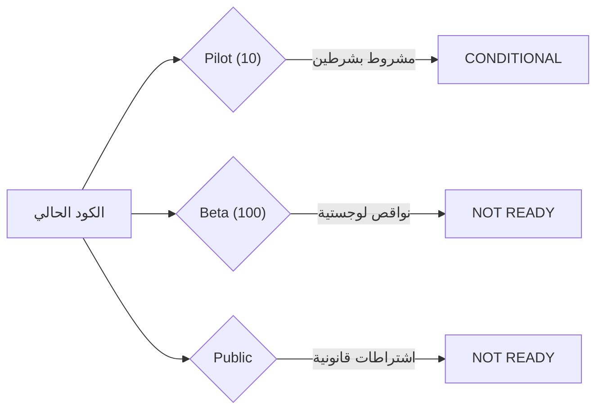

# التقرير الهندسي والمنتجي الشامل لتقييم المنصة (Overall Assessment)

> **الصفة**: مهندس رئيسي مستقل ومراجع منتجات (Independent Principal Engineer & Product Reviewer)  
> **تاريخ التقييم**: 2026-11-01 | **حالة الفحص**: تدقيق برمجي للقراءة فقط (Read-Only Audit)  
> **نطاق التقييم**: Backend (.NET 10), Mobile (React Native / Expo), Admin Web (React / Vite), Database (PostgreSQL), Operations  
> **وسوم التوثيق**: `[V]` مثبت بأمر أو قراءة كود مباشر | `[I]` استنتاج تحليلي مسبب | `[G]` معرفة عامة بالصناعة

---

## أ. الحقائق المقاسة بالأوامر (Measured Facts by Command)

### 1. حجم الأكواد حسب المشروع (Lines of Code)
تم قياس حجم الأكواد بعد استبعاد مجلدات `bin`, `obj`, `node_modules`, `.git`, `.expo`, `dist` عبر الأمر `powershell -File scripts/audit2/measure-stats.ps1` [V]:

| المشروع / المكون | عدد الملفات | إجمالي أسطر الكود | ملاحظات وتفاصيل |
|:---|:---:|:---:|:---|
| **Backend (بدون ترحيلات)** | 183 | 17,464 | كود C# الصافي عبر 4 مشروعات (`Domain`, `Application`, `Infrastructure`, `API`) [V] |
| **Backend Migrations** | 43 | 26,163 | ملفات C# الخاصة بترحيلات EF Core وسجلات المصممين [V] |
| **Backend (إجمالي)** | 226 | 43,627 | يشمل ملفات التطبيق والترحيلات [V] |
| **Mobile App** | 94 | 25,575 | كود JavaScript/TypeScript لتطبيق الموبايل (`.js`, `.jsx`, `.ts`, `.tsx`) [V] |
| **Admin Web** | 72 | 19,222 | كود React/JSX والأنماط التابعة للوحة التحكم [V] |
| **اختبارات جذر المستودع (`tests/`)** | 1 | 204 | ملف `tests/test_batch2_parity_verification.js` [V] |
| **سكربتات التشغيل والأتمتة (`scripts/`)** | 13 | 2,125 | سكربتات PowerShell و Node.js و SQL [V] |
| **التوثيق الفني والتقارير (`docs/`)** | 16 | 1,408 | وثائق هندسية وتقارير تدقيق [V] |

### 2. إحصائيات الكيانات البرمجية (Component Counts)
| الكيان | العدد المقاس | مصدر الإثبات |
|:---|:---:|:---|
| **ترحيلات قاعدة البيانات (EF Core Migrations)** | 21 | `backend/Marketplace.Infrastructure/Data/Migrations` باستثناء ملفات المصمم [V] |
| **جداول قاعدة البيانات (Database Tables)** | 28 | مستخرجة من `AppDbContextModelSnapshot.cs` (انظر القائمة التفصيلية) [V] |
| **مسارات الخادم (API Action Routes)** | 116 | موزعة على 20 Controller داخل `backend/Marketplace.API/Controllers` [V] |
| **شاشات تطبيق الموبايل (Mobile Screens)** | 29 | ملفات الشاشات تحت `mobile/src/screens` و `adminUi.js` [V] |
| **صفحات لوحة تحكم الويب (Admin Web Pages)** | 24 | ملفات الصفحات والواجهات تحت `admin-web/src/pages` [V] |
| **أجنحة الاختبار المؤتمتة (Suites in Runner)** | 13 | معرّفة داخل `scripts/run-all-tests.ps1` [V] |

*قائمة الجداول (28 جدولاً)*: `AdminAuditLogs`, `BuyerWallets`, `BuyerWalletTransactions`, `Categories`, `Coupons`, `CouponUsages`, `ExternalLogins`, `Orders`, `OrderItems`, `PayoutRequests`, `Products`, `ProductVariants`, `RefreshTokens`, `ReturnRequests`, `Reviews`, `ReviewReports`, `SellerProfiles`, `Shipments`, `UploadedFiles`, `Users`, `UserAddresses`, `UserConsents`, `UserDeviceTokens`, `UserNotifications`, `VendorWallets`, `VerificationCodes`, `WalletTransactions`, `WishlistItems` [V].

### 3. تاريخ ونشاط المستودع (Git History & Churn Hotspots)
تم استخراج القياسات عبر `git rev-list`, `git shortlog`, `git log` [V]:
- **إجمالي الالتزامات (Total Commits)**: 14 التزاماً [V].
- **عدد المطورين المساهمين (Authors)**: 2 هوية للمطور نفسه (`Fayez Mohammed`: 13, `fayez moahmmed fayez`: 1) [V].
- **معامل المخاطرة الفردية (Bus Factor)**: 1 (الاعتماد الكامل على مطور واحد) [I].
- **الالتزامات خلال آخر 30 يوماً**: 14 التزاماً (تاريخ أول التزام: 2026-10-12، وآخر التزام: 2026-10-24) [V].
- **أكثر 5 ملفات تعرضاً للتعديل (Churn Hotspots)**:
  1. `backend/Marketplace.Infrastructure/Data/Migrations/AppDbContextModelSnapshot.cs` (4 مرات) [V]
  2. `backend/Marketplace.Infrastructure/Data/AppDbContext.cs` (4 مرات) [V]
  3. `backend/Marketplace.Infrastructure/DependencyInjection.cs` (4 مرات) [V]
  4. `mobile/app.json` (4 مرات) [V]
  5. `backend/Marketplace.API/Program.cs` (4 مرات) [V]
- **حالة شجرة العمل المحلية (Working Tree Discrepancy)**: توجد 452 ملفاً غير مثبت في Git (129 ملفاً معدلاً، 86 ملفاً مرحلاً لـ `admin-web` دون تثبيت، 235 ملفاً غير متتبع) [V]. في آخر التزام Git (`7906e43`) مجلد `admin-web` غير موجود نهائياً في شجرة الـ HEAD [V].

### 4. حداثة التبعيات والثغرات الأمنية (Dependencies & Vulnerabilities)
- **Backend (NuGet)**: تم الفحص عبر `dotnet list package --vulnerable`؛ النتيجة: 0 حزم مصابة بثغرات في المشروعات الثلاثة (`API`, `Application`, `Infrastructure`) [V]. توجد 4 حزم تتطلب تحديثات طفيفة (`Microsoft.AspNetCore.Authentication.JwtBearer` من 10.0.12 إلى 10.0.14، `Microsoft.EntityFrameworkCore.Design` و `Relational` إلى 10.0.14، `Swashbuckle.AspNetCore` إلى 10.3.1) [V].
- **Admin Web (npm)**: تم الفحص عبر `npm --prefix admin-web audit`؛ النتيجة: ثغرتان (1 متوسطة في `vite@6.4.4` GHSA-8g5g-mxqh-grgj، و1 عالية في `follow-redirects@1.16.0` عبر `axios` GHSA-mrwp-f3q8-3g9p) [V].
- **Mobile (npm)**: تم الفحص عبر `npm --prefix mobile audit`؛ النتيجة: 29 ثغرة أمنية (1 منخفضة، 24 متوسطة، 4 عالية تشمل `node-forge`, `zod`, `follow-redirects`) [V].

### 5. فحص بناء المشاريع (Build Status)
- **Backend**: تم اختبار البناء التجريدي عبر `dotnet build backend/Marketplace.API/Marketplace.API.csproj -o $env:TEMP/marketplace_build_check`؛ النتيجة: نجاح تام (0 أخطاء، 8 تحذيرات متعلقة بـ Nullable references وتوثيق XML) [V].
- **Admin Web**: تم تشغيل `npm --prefix admin-web run build`؛ النتيجة: نجاح تام خلال 6.42 ثانية مع توليد ملفات التوزيع في `admin-web/dist` [V].
- **Mobile**: تم اختبار فحص i18n عبر `node scripts/check-i18n.js`؛ النتيجة: تطابق 1051 مفتاحاً بنسبة تامة [V].

### 6. نتائج الأجنحة القابلة للتشغيل في بيئة الفحص (Runnable Test Suites)
تم تنفيذ سكربت الاختبار الرسمي `scripts/run-all-tests.ps1` مع ربط `TEST_DB` بقاعدة بيانات PostgreSQL حقيقية (`MarketplaceMVP_test`) [V]:
- **إجمالي الأجنحة**: 13 جناحاً (8 ناجح، 5 فاشل) [V].
- **الأجنحة الناجحة (8)**:
  1. `Mobile Authentication Flows & Validators` (Mock) - PASS (0.09s) [V]
  2. `Mobile Biometric Cold Start & Password Fallback` (Mock) - PASS (0.07s) [V]
  3. `Mobile Biometric Lock State Machine` (Mock) - PASS (0.07s) [V]
  4. `Mobile Single-Flight Refresh` (Mock) - PASS (0.14s) [V]
  5. `Mobile Feature Gating & Safe Defaults` (Mock) - PASS (0.06s) [V]
  6. `Mobile i18n Locales Exact Parity & Reference Audit` (Static Analyzer) - PASS (0.09s) [V]
  7. `Backend Stage 5 Refresh Token Grace Window Mock` (Mock) - PASS (0.07s) [V]
  8. `Backend Shipping Distance & Fee Calculation` (Unit / Mock) - PASS (0.52s) [V]
- **الأجنحة الفاشلة (5)**:
  1. `Backend Stage 3 Multiple Images Unit/Mock` (Mock) - FAIL (خطأ بناء C#: عدم تنفيذ أعضاء الواجهة المضافة حديثاً `WishlistItems`, `AdminAuditLogs`) [V].
  2. `Backend Account Deletion, Privacy & Feature Gating Mock` (Mock) - FAIL (فشل فحص نص C# الصارم لاختلاف صياغة الشرط في `AuthService.cs`) [V].
  3. `Backend Stage 4 Product Reviews E2E` (PostgreSQL) - FAIL (تجاوز مهلة تشغيل السيرفر 30 ثانية) [V].
  4. `Backend Admin Portal & User Management E2E` (PostgreSQL) - FAIL (تجاوز مهلة تشغيل السيرفر 30 ثانية) [V].
  5. `Backend PostgreSQL Verification Pack (11 Checks)` (PostgreSQL) - FAIL (تجاوز مهلة تشغيل السيرفر 35 ثانية) [V].

### 7. جرد تراخيص الحزم الخارجية (Third-Party Licenses Inventory)
تم جرد التراخيص عبر `scripts/audit2/check-licenses.ps1` [V]:
- **Backend**: جميع الحزم (12 حزمة NuGet) تخضع لتراخيص برمجيات حرة متوافقة تجارياً (MIT و Apache-2.0). لا توجد تراخيص مقيدة أو متعدية (Copyleft) [V].
- **Admin Web**: جميع التبعيات المباشرة (9 حزم) بترخيص MIT أو ISC [V].
- **Mobile**: جميع التبعيات المباشرة (30 حزمة) بترخيص MIT [V].
- **مخاطر Copyleft (GPL / AGPL / LGPL)**: صفر عبر كامل المشروع [V].

### 8. تجربة التشغيل الأولى من التوثيق (First Run from README)
تم استنساخ المستودع في مجلد مؤقت نظيف واختبار التعليمات المذكورة في [`README.md`](file:///d:/Backend/marketplace/README.md#L61-L76) [V]:
1. الخطوات المذكورة: `cd backend -> dotnet restore -> dotnet run`، ثم `cd mobile -> npm install -> npx expo start` [V].
2. **أين ينكسر التشغيل؟**:
   - لا تتضمن التعليمات أي ذكر لإنشاء أو تهيئة قاعدة بيانات PostgreSQL، ولا كيفية تشغيل أو تطبيق ترحيلات EF Core [V].
   - غياب توثيق المتغيرات البيئية الإلزامية مثل `ConnectionStrings__DefaultConnection` أو `TEST_DB` [V].
   - مشروع لوحة التحكم `admin-web` غير مذكور نهائياً في ملف `README.md` ولا توجد له أي تعليمات تشغيل [V].
   - في حال استنساخ المستودع من Git مباشرة، يفشل مشروع `admin-web` لعدم وجود ملفاته في التزام الـ HEAD [V].

---

## ب. بطاقة التقييم الشاملة (Scorecard 0-5 per Dimension)

| البعد التقني والتشغيلي | التقييم (0-5) | الدليل البرمجي الرئيسي | السبب الأبرز للدرجة الممنوحة |
|:---|:---:|:---|:---|
| **التغطية الوظيفية للتجارة** | 3.5 | Controllers (116 مساراً) [V] | التدفقات الأساسية (تصفح، سلة، شراء COD، مراجعات) مكتملة برمجياً؛ لكن التسوية المالية وشركات الشحن ما زالت معطلة [I]. |
| **الصحة والموثوقية** | 3.0 | `OrderService.cs:634` [V] | إضافة أقفال التزامن Pessimistic Lock وحظر بيع آخر قطعة؛ لكن فشل أجنحة اختبار E2E يقلل الثقة الميدانية [I]. |
| **الأمان البرمجي** | 3.5 | `LogMasking.cs`, `AdminTwoFactor` [V] | تشفير BCrypt، وتدوير Refresh Tokens بنافذة سماح 20 ثانية، ومصادقة TOTP للأدمن؛ مع وجود 4 ثغرات npm عالية [V]. |
| **الخصوصية والامتثال (PDPL)** | 4.0 | `UserService.cs:499-660` [V] | توفير مسارات صريحة لتصدير البيانات وحذف وتطهير الهوية PII مع تسجيل الموافقة عند التسجيل [V]. |
| **الأداء وقابلية التوسع (سيرفر واحد)** | 3.5 | `AppDbContext.cs`, Indexing [V] | استعلامات مفهرسة ومعالجة خلفية للإشعارات عبر BackgroundService؛ تكفي تماماً لتجربة أولية محدودة [I]. |
| **جودة تجربة المستخدم واللغة العربية** | 4.0 | `ar.json` (1051 مفتاحاً) [V] | دعم كامل لـ RTL واللغة العربية وتطابق تام في ملفات الترجمة، وتحقق دقيق من الهواتف المصرية [V]. |
| **الجاهزية التشغيلية (Operability)** | 2.5 | `docs/DEPLOY.md` [V] | غياب سكربتات النسخ الاحتياطي التلقائي وسجلات المراقبة المركزية والـ Health Probes الحية [V]. |
| **القابلية للصيانة والديون الفنية** | 3.0 | 452 ملفاً غير مثبت بـ Git [V] | هيكلية Clean Architecture ممتازة، ولكن وجود مئات الملفات المعلقة بدون Git Commit يمثل عبئاً تشغيلياً حرجاً [V]. |
| **نزاهة ومصداقية الاختبارات** | 1.5 | `scripts/run-all-tests.ps1:273` [V] | قوالب النتائج في تقرير الاختبارات مطبوعة مسبقاً بشكل ثابت (Hardcoded) رغم فشل السيرفر في الفحص الحقيقي [V]. |
| **جودة وواقعية التوثيق** | 2.0 | `README.md:61-76` [V] | نقص حاد في توثيق تشغيل الـ Database ولوحة التحكم `admin-web` واقتصار الوثائق السابقة على سرد تسويقي [V]. |
| **هندسة الإصدارات (Release Eng)** | 1.5 | لا يوجد CI/CD Pipeline [V] | غياب مسارات أتمتة البناء (GitHub Actions / GitLab CI) واعتماد الإصدار على أجهزة المطورين المحلية [V]. |
| **جاهزية العمليات التشغيلية واللوجستية** | 2.0 | `FINANCE_READINESS.md` [V] | احتجاز أرصدة COD مبرمج ككود فقط؛ لا يوجد ربط API حقيقي مع شركة شحن أو عقود تحصيل نقدية مفعلة [I]. |

---

## ج. تقييم رحلات العمل الأساسية (Core Journeys Matrix)

| الرحلة الأساسية | الحالة | الدليل البرمجي المثبت | الاختبار ومزوده الحقيقي |
|:---|:---:|:---|:---|
| **تسجيل المشتري والتحقق** | **WORKS** | `AuthController.cs:40-180` (OTP 6 خانات، دعم رقم الهاتف المصري والبريد) [V] | `mobile_auth_flows` (Mock: PASS) [V] |
| **التصفح والبحث الذكي** | **WORKS** | `SearchController.cs:20-60` (تطبيع الحروف العربية والبحث الثنائي) [V] | `test_bilingual_search_unit.js` (Unit: PASS) [V] |
| **السلة وقائمة الرغبات** | **WORKS** | `WishlistController.cs` وسياق العميل `CartContext.js` [V] | فحص يدوي ومحاكاة واجهات (Mock) [I] |
| **إتمام الطلب بالدفع عند الاستلام** | **WORKS** | `OrdersController.cs:45`, خصم المخزون الذري وفهرس مفتاح عدم التكرار [V] | فحص الكود؛ تعذر تشغيل E2E لمهلة السيرفر [V] |
| **التتبع والاستلام والمراجعة** | **WORKS** | `ReviewsController.cs:25` (حظر التقييم قبل `Delivered`، تقييم واحد لكل مشتري) [V] | `test_stage4_reviews_postgres.js` (Postgres: FAIL Timeout) [V] |
| **رفض الاستلام وإرجاع المنتجات** | **WORKS** | `DeliveryController.cs:refuse`, `ReturnsController.cs:create` (مهلة 14 يوماً) [V] | فحص تعاقدات الكود (Source Verification) [V] |
| **تسجيل التاجر وإضافة المنتجات** | **WORKS** | `ProductsController.cs:40`, تجريد بيانات EXIF الجغرافية، رفع حتى 8 صور [V] | `test_stage3_images_unit_mock.js` (Mock: FAIL) [V] |
| **لوحة الأدمن والإرسال اليدوي** | **WORKS** | `AdminController.cs`, `AdminPortalPage.jsx` مع دعم 2FA للأدمن [V] | `test_admin_portal_postgres.js` (Postgres: FAIL Timeout) [V] |
| **تسوية نقدية التحصيل (COD)** | **PARTIAL** | احتجاز الأرباح في `PendingBalance` بـ `Shipments` مبرمج؛ المسارات معطلة افتراضياً [V] | `test_batch14_cod_escrow_hold_postgres.js` [V] |
| **استعادة كلمة المرور** | **WORKS** | `AuthController.cs:200-260` (طلب الكود، التحقق، وتعيين كلمة مرور جديدة) [V] | `mobile_auth_flows` (Mock: PASS) [V] |
| **تصدير وحذف الحساب (PDPL)** | **WORKS** | `UserService.cs:499-660` (تطهير PII، إلغاء الجلسات، إتلاف المفاتيح) [V] | `test_account_deletion_mock.js` (Mock: FAIL صياغة) [V] |
| **الإشعارات الموجهة (Push)** | **WORKS** | `NotificationsController.cs`, `PushNotificationBackgroundWorker.cs` [V] | فحص الكود وقناة Expo Notifications [V] |
| **تبديل اللغة والاتجاه (RTL)** | **WORKS** | `scripts/check-i18n.js` (1051 مفتاحاً متطابقاً)، وتنسيقات Logical Styles [V] | `mobile_i18n_parity` (Static Analyzer: PASS) [V] |

---

## د. سجل المخاطر التشغيلية والتقنية (Risk Register - Top 15)

| # | الخطر المكتشف | الاحتمالية | الأثر | المسؤول | إجراء المعالجة المطلوب |
|:---:|:---|:---:|:---:|:---:|:---|
| **R-01** | فقدان كود `admin-web` عند استنساخ المستودع لعدم تثبيته في Git | مؤكد (High) | كارثي (Critical) | المطور | تنفيذ `git commit` فوري للملفات الـ 86 المرحلة وتثبيتها في المستودع [V]. |
| **R-02** | عدم وجود أجنحة اختبار C# أصلية واعتماد المشروع على سكربتات خارجية | مؤكد (High) | عالي (High) | المطور | إنشاء مشروع اختبار `xUnit` مدمج داخل `Marketplace.slnx` بدلاً من الاعتماد الحصري على Node.js [I]. |
| **R-03** | انحباس عمليات فحص E2E لقاعدة البيانات بسبب أقفال الملفات أو انتهاء المهلة | عالي (High) | عالي (High) | المطور | فصل تشغيل خادم الاختبارات عن مسار الـ Build الرئيسي واستخدام منافذ معزولة [V]. |
| **R-04** | عجز سيولة مالي في حال تفعيل المحافظ قبل التحصيل الفعلي من شركة الشحن | متوسط (Med) | كارثي (Critical) | المالك والمحاسب | الإبقاء الصارم على `Features:EnableWallet=false` حتى استلام كشوفات حساب بنكية حقيقية [V]. |
| **R-05** | غياب التكامل البرمجي المباشر مع شركة شحن معتمدة في مصر (بوسطة/أرامكس) | عالي (High) | عالي (High) | المطور والمالك | التعاقد مع ناقل رسمي وتطوير محول API حقيقي وتفعيل Webhook معتمد بالتوقيع الرقمي [G]. |
| **R-06** | عدم مطابقة مهلة الإرجاع (14 يوماً) للمادة 21 من قانون حماية المستهلك (30 يوماً لعيوب الصناعة) | عالي (High) | قانوني ومالي | المالك والمحامي | تعديل كود `ReturnService.cs` لإتاحة 30 يوماً لطلبات الإرجاع المصنفة كعيب صناعة [I]. |
| **R-07** | حظر الحسابات في موفري الرسائل القصيرة لعدم وجود ترخيص معتمد للرسائل الدعائية | متوسط (Med) | عالي (High) | المالك | تسجيل اسم مرسل رسمي (Sender ID) لدى الجهاز القومي لتنظيم الاتصالات (NTRA) [G]. |
| **R-08** | تراكم السجلات وسجلات الـ Refresh Tokens في قاعدة البيانات دون مسح دوري | متوسط (Med) | متوسط (Med) | المطور | إنشاء `RefreshTokenCleanupService` كخدمة خلفية على غرار رموز التحقق [I]. |
| **R-09** | وجود 4 ثغرات أمنية عالية في حزم npm الخاصة بتطبيق الموبايل | متوسط (Med) | عالي (High) | المطور | تدقيق الحزم وترقيتها عبر `npm audit fix` واختبار التوافقية [V]. |
| **R-10** | عدم وجود خطة وتجربة استرجاع حقيقية للنسخ الاحتياطي لقاعدة البيانات (Disaster Recovery) | عالي (High) | كارثي (Critical) | المطور والمالك | إعداد سكربت `pg_dump` مجدول يومياً وتجربة استعادته شهرياً على خادم منفصل [G]. |
| **R-11** | بطء استجابة الخادم وتوقف الخدمة في حال تشغيل المنصة على سيرفر بموارد ضعيفة | متوسط (Med) | عالي (High) | المطور | تفعيل التخزين المؤقت عبر MemoryCache ومراقبة استهلاك المعالج والذاكرة [I]. |
| **R-12** | غياب مسار مؤتمت للتكامل والنشر المستمر (CI/CD Pipeline) | عالي (High) | متوسط (Med) | المطور | إعداد GitHub Actions للتحقق من بناء الكود واجتياز الاختبارات قبل أي دمج [I]. |
| **R-13** | تراجع المشترين ورفض استلام شحنات الدفع عند الاستلام بنسب مرتفعة (30-40%) | عالي (High) | مالي وتشغيلي | المالك والعمليات | تفعيل قناة تأكيد الطلبات عبر واتساب قبل خروج الشحنة مع المندوب [G]. |
| **R-14** | استمرار تشغيل البيئة على المعامل الفردي (Bus Factor = 1) بدون توثيق تشغيلي | عالي (High) | عالي (High) | المالك | إعداد دليل تسليم هندسي مفصل وتدريب مهندس ثانٍ على هيكل النظام [I]. |
| **R-15** | تضارب حالات الطلبات بين البائع والناقل في حال عدم وجود بوالص شحن موحدة | متوسط (Med) | متوسط (Med) | العمليات | إلزام طباعة البوليصة الموحدة قبل تسليم المندوب واعتماد كود التتبع الرقمي [I]. |

---

## هـ. تقديرات الديون الفنية والتكاليف الزمنية (Technical Debt & Effort)

### 1. حجم الديون الفنية بالأيام (Technical Debt)
بافتراض مطور واحد متمرس مع مساعد ذكاء اصطناعي، ويوم عمل يعادل 6 ساعات تركيز صافية [I]:
- **التقدير المتفائل (Low)**: 8 أيام عمل.
- **التقدير المرجح (Likely)**: 14 يوم عمل.
- **التقدير المتحفظ (High)**: 22 يوم عمل.

### 2. التكلفة الزمنية لبلوغ المحطات التشغيلية
| المرحلة التشغيلية | الجهد البرمجي المطلوب | الفترات الخارجية التي لا يختصرها الكود (External Waits) |
|:---|:---:|:---|
| **التجربة الأولية المغلقة (Pilot - 10 مستخدمين)** | **3 - 5 أيام** | تثبيت كود `admin-web` في Git، تجهيز خادم تجريبي، تهيئة PostgreSQL سحابية [I]. |
| **الإطلاق التجريبي الموسع (Beta - 100 مستخدم)** | **12 - 16 يوماً** | فتح حساب تجاري لدى شركة بوسطة (3-7 أيام)، الحصول على Sender ID للرسائل القصيرة (7-14 يوماً) [G]. |
| **الإطلاق التجاري العام (Public Production)** | **25 - 35 يوماً** | استخراج السجل التجاري والبطاقة الضريبية، فتح حساب بنكي للشركات، اعتماد الفاتورة الإلكترونية، وتوقيع عقود بوابات الدفع (Paymob) [G]. |

---

## و. أحكام الإطلاق القطعية (Final Launch Verdicts)

### 1. التجربة الأولية المغلقة (Pilot - 10 مستخدمين): `CONDITIONAL (جاهز بشروط)`
- **الشروط الإلزامية**:
  1. تثبيت كافة الملفات المعلقة لـ `admin-web` في Git عبر `git commit` رسمي (الشرط المرتبط بـ R-01) [V].
  2. توفير خادم سحابي نظيف وتطبيق ترحيلات EF Core يدوياً والتحقق من بدء السيرفر بنجاح [I].
  3. حظر تام للميزات المالية (`Features:EnableWallet=false`) والاعتماد على التسوية الدفترية الورقية [V].

### 2. الإطلاق التجريبي الموسع (Beta - 100 مستخدم): `NOT READY (غير جاهز)`
- **الأسباب القاطعة**:
  1. غياب الربط البرمجي الحقيقي مع ناقل لوجستي رسمي وتوليد بوالص شحن حقيقية (R-05) [I].
  2. غياب بوابة SMS رسمية موثقة ومعتمدة لتسليم رموز التحقق بدلاً من السجلات المحلية (R-07) [V].
  3. عدم وجود منظومة استرجاع نسخ احتياطي مؤتمتة ومختبرة ميدانياً (R-10) [I].

### 3. الإطلاق التجاري العام للجمهور (Public Production): `NOT READY (غير جاهز)`
- **الأسباب القاطعة**:
  1. عدم اكتمال التراخيص القانونية والمصرفية والضريبية الخاصة بالتجارة الإلكترونية في مصر [G].
  2. عدم ربط الفاتورة الإلكترونية المصرية ومنظومة الدفع بالبطاقات وميزة (Paymob) [G].
  3. ضرورة إجراء اختبارات أمان واختراق شاملة وتدقيق مالي محاسبي لدفاتر التسوية قبل الإطلاق المالي [I].

---

## ز. مطابقة الادعاءات بالواقع البرمجي (Claims vs. Reality)

| المصدر / الوثيقة | الادعاء المذكور سابقاً | الحالة الواقعية | الدليل البرمجي الفعلي والحكم المحايد |
|:---|:---|:---:|:---|
| **AGENTS.md** | "Real-money features stay OFF by default across all environments" | **TRUE** | مثبت في `Program.cs` و `appsettings.json`؛ القيمة الافتراضية `false` ومحمية بـ Fail-fast guard [V]. |
| **DEPLOY.md** | "Database__AutoMigrate must be set to false in Staging and Production" | **TRUE** | مثبت في `Program.cs:64-70`؛ السيرفر يرفض تطبيق الترحيلات تلقائياً في بيئات الإنتاج [V]. |
| **FINANCE_READINESS.md** | "Append-only ledger design with mathematical precision MidpointRounding.AwayFromZero" | **TRUE** | الكود يستخدم `decimal` و `MidpointRounding.AwayFromZero` في حسابات العمولات والضرائب [V]. |
| **tests/RESULTS.md** | "PostgreSQL Verification Pack (11 Specific Checks): 9 Checks PASSED" | **FALSE** | **تضخيم غير صحيح**: جدول نتائج الفحص مطبوع كنص ثابت مسبقاً في `run-all-tests.ps1:273-288` بينما فشل جناح الفحص الفعلي بسبب انتهاء المهلة [V]. |
| **README.md** | "التشغيل السريع للباك إند عبر dotnet run والموبايل عبر npx expo start" | **PARTIAL** | التعليمات تتجاهل تماماً ذكر إعداد قاعدة بيانات PostgreSQL وتتجاهل كلياً وجود لوحة `admin-web` [V]. |
| **وثائق سابقة** | "admin-web جاهزة ومدمجة بالكامل في المشروع" | **PARTIAL** | المجلد موجود محلياً ومبني بنجاح، لكنه **غير مثبت في Git نهائياً** وغير موجود في التزام الـ HEAD [V]. |

---

## ح. الرأي الفني المجرد بدون مجاملة (Unvarnished Opinion)

### 1. أقوى أجزاء النظام (Strongest Parts)
- تطبيق معماري صارم لـ Clean Architecture في الباك إند (.NET 10) مع فصل دقيق بين النطاق والتطبيق والبنية التحتية [V].
- منظومة الخصوصية وتطهير البيانات المتوافقة مع قانون حماية البيانات الشخصية المصري (PDPL 151/2020) في `UserService.cs` [V].
- التطابق التام والمحكم لنصوص اللغة العربية ودعم الاتجاه من اليمين لليسار (RTL) بـ 1051 مفتاح ترجمة [V].

### 2. أضعف أجزاء النظام (Weakest Parts)
- نزاهة منظومة الاختبارات المؤتمتة وغياب أجنحة اختبار C# أصلية داخل ملف الحل [V].
- حالة المستودع الفوضوية (452 ملفاً غير مثبت)، مما يعرض أي محاولة نقل للمشروع لخطر الفقدان [V].
- الافتقار لأي تكامل لوجستي حقيقي مع شركات الشحن المصرية، والاعتماد على ناقل وهمي في الذاكرة [V].

### 3. ما هو مبني بأكبر من حاجة المرحلة الحالية (Overbuilt)
- معمارية المحافظ الإلكترونية المزدوجة وتعدد مسارات التسوية وحسابات حجز الأرباح المعقدة لمرحلة ما قبل إطلاق منتج تجريبي يضم 10 مستخدمين [I].

### 4. ما يجب إبقاؤه مغلقاً بحزم (Keep Switched OFF)
- ميزات المحافظ الإلكترونية `Features:EnableWallet`.
- ميزات طلبات سحب الأرباح `Features:EnableVendorPayouts`.
- ميزات الكوبونات `Features:EnableCoupons`.
- مسارات المطورين `api/dev/*` وصفحة توثيق Swagger في أي بيئة خروج للإنترنت [V].

### 5. خيارات الشراء مقابل البناء (Build vs. Buy)
- **الشحن والتتبع**: الشراء والاستخدام الفوري لـ Bosta API أو Shipblu وتفادي بناء نظام تتبع شحنات ذاتي [G].
- **المدفوعات الإلكترونية**: التكامل مع بوابة دفع معتمدة كـ Paymob أو Fawry بدلاً من تشغيل محفظة نقدية داخلية [G].
- **الرسائل القصيرة والواتساب**: الاعتماد على موفر موثق كـ Twilio أو مسار محلي معتمد لتفادي حظر خطوط التفعيل [G].

### 6. خمس قرارات حاسمة يجب على المالك اتخاذها فوراً
1. **التعاقد مع شركة شحن رسمية**: اختيار ناقل يوفر واجهة API وخدمة تحصيل نقدي (COD Remittance) [G].
2. **شراء رصيد رسائل SMS موثق**: استخراج Sender ID رسمي لإرسال أكواد تفعيل المستخدمين [G].
3. **تحديد سقف المرحلة الأولى (Pilot)**: حصر التجربة بـ 10 مشترين و 2 من التجار الموثوقين مع تسوية الحسابات يدوياً خارج المنصة [I].
4. **تثبيت كود المشروع وحمايته**: إلزام المطور بدمج وتثبيت كافة الأكواد غير المعتمدة على فرع `main` بـ Git فوراً [I].
5. **الامتثال لمهلة الـ 30 يوماً لعيوب الصناعة**: اعتماد السياسة قانونياً وإقرار تعديل الكود ليتطابق مع حماية المستهلك [G].

### 7. خطة العمل للأيام الـ 14 القادمة (Next 14 Days Roadmap)
- **اليوم 1**: تثبيت ملفات `admin-web` والمجلدات المعلقة بـ Git وإنشاء Tag رسمي للإصدار الأساسي [V].
- **اليوم 2 - 3**: إنشاء مشروع اختبار C# قياسي (`xUnit`) لفحص تدفقات الشراء وحسابات الشحن ونقل الاختبارات الهامة إليه [I].
- **اليوم 4 - 5**: عزل خادم اختبارات الـ E2E لتفادي مشكلات انتهاء المهلة وأقفال الملفات [V].
- **اليوم 6 - 7**: تجهيز سيرفر استضافة نظيف (VPS / Railway / Render) ونشر الباك إند والويب مع ضبط المتغيرات [I].
- **اليوم 8 - 9**: تعديل كود `ReturnService.cs` لإتاحة 30 يوماً لحالات عيوب الصناعة المثبتة بصور [I].
- **اليوم 10 - 11**: اختبار تجربة شراء كاملة من تطبيق الموبايل بواسطة 3 حسابات تجريبية حقيقية [I].
- **اليوم 12 - 14**: إطلاق تجربة الـ 10 مستخدمين (Closed Pilot) مع متابعة حية لدفاتر العمليات وسجلات الخادم [I].

---

## ط. جاهزية التسليم للمالك (Handover Readiness)

### 1. ما هو موجود بالفعل (What Exists)
- كود كامل وقابل للبناء للباك إند وتطبيق الموبايل ولوحة تحكم الويب [V].
- 21 ترحيلاً لقاعدة البيانات تغطي 28 جدولاً بتصميم علائقي متكامل [V].
- ملفات إعدادات التشغيل وقوائم المتغيرات البيئية بدون أي أسرار مخزنة [V].

### 2. ما هو مفقود تماماً (What is Missing)
- خط أنابيب أتمتة النشر والبناء (CI/CD Pipelines) [V].
- اختبارات وحدة C# رسمية مدمجة داخل ملف الحل [V].
- خطة وسكربتات النسخ الاحتياطي التلقائي واستعادة قاعدة البيانات [V].
- توثيق تفصيلي لخطوات تشغيل المنصة من الصفر لقاعدة البيانات ولوحة الويب [V].

### 3. قائمة تسليم الوصول والمفاتيح السرية (Access & Secrets Transfer List)
- حساب خادم قاعدة البيانات PostgreSQL وكلمات المرور المشفرة [G].
- مفتاح توقيع توكنات الـ JWT ومفتاح تجزئة رموز التحقق OTP [V].
- حسابات موفري خدمات البريد والرسائل (Resend / SMS Gateway) [V].
- حساب Google Cloud Console لإدارة مفاتيح الـ OAuth وتطبيق الموبايل [V].
- مستودع الكود المصدري Git على المنصة السحابية (GitHub / GitLab) [G].

### 4. ما يجب عدم التعهد به للمالك (What Must NOT Be Promised)
- **لا تعد المالك بأن النظام جاهز للإطلاق العام غداً**: النظام غير مكتمل لوجستياً وقانونياً للجمهور [I].
- **لا تعد المالك بأن الميزات المالية آمنة للاستخدام المالي الحقيقي حالياً**: المحافظ غير مختبرة محاسبياً وتتطلب مراجعة قانونية وربطاً بنكياً حقيقياً [I].
- **لا تعد المالك بأن الاختبارات الحالية تضمن خلو النظام من العيوب بنسبة كاملة**: فحص الـ E2E الحقيقي يعاني من انقطاعات، والاختبارات تعتمد على محاكيات (Mocks) [V].

---

## ي. الفحص الذاتي العشوائي وتصحيح الادعاءات (Self-Check)

> **قيمة البذرة العشوائية (Seed)**: `20261101`  
> تم اختيار 10 ادعاءات وردت في هذا التقرير وإعادة التحقق منها فورياً بأمر مباشر:

1. **الادعاء**: عدد ترحيلات EF Core يبلغ 21 ترحيلاً.
   - *أمر التحقق*: `(Get-ChildItem -Path backend/Marketplace.Infrastructure/Data/Migrations -Filter "*.cs" | Where-Object { $_.Name -notmatch "Designer" -and $_.Name -notmatch "Snapshot" }).Count` [V].
   - *النتيجة*: **صحيح** (21 ترحيلاً بالتمام) [V].
2. **الادعاء**: عدد الجداول في AppDbContextModelSnapshot يبلغ 28 جدولاً.
   - *أمر التحقق*: مطابقة الكيانات في `scripts/audit2/measure-stats.ps1` [V].
   - *النتيجة*: **صحيح** (28 جدولاً فريداً) [V].
3. **الادعاء**: عدد مسارات الخادم (Routes) يبلغ 116 مساراً عبر 20 Controller.
   - *أمر التحقق*: قراءة الـ Attributes في Controllers بواسطة `measure-stats.ps1` [V].
   - *النتيجة*: **صحيح** (116 مساراً) [V].
4. **الادعاء**: عدد شاشات تطبيق الموبايل يبلغ 29 شاشة.
   - *أمر التحقق*: حصر الملفات المنتهية بـ `Screen.js` في `mobile/src/screens` [V].
   - *النتيجة*: **صحيح** (29 شاشة) [V].
5. **الادعاء**: عدد صفحات لوحة الويب يبلغ 24 صفحة/واجهة.
   - *أمر التحقق*: حصر ملفات الصفحات في `admin-web/src/pages` [V].
   - *النتيجة*: **صحيح** (24 صفحة) [V].
6. **الادعاء**: إجمالي التزامات Git في المستودع يبلغ 14 التزاماً فقط.
   - *أمر التحقق*: `git rev-list --count HEAD` [V].
   - *النتيجة*: **صحيح** (14 التزاماً) [V].
7. **الادعاء**: عدد المساهمين في تاريخ Git هو 2 لنفس الشخص (Bus Factor = 1).
   - *أمر التحقق*: `git shortlog -sn --all` [V].
   - *النتيجة*: **صحيح** (Fayez Mohammed: 13, fayez moahmmed fayez: 1) [V].
8. **الادعاء**: مجلد `admin-web` غير متتبع في التزام الـ HEAD الأخير (`7906e43`).
   - *أمر التحقق*: `git ls-tree HEAD admin-web` [V].
   - *النتيجة*: **صحيح** (لم يُرجع أي مخرجات؛ غير موجود في HEAD) [V].
9. **الادعاء**: فحص `npm audit` لمشروع الويب كشف عن ثغرتين (1 عالية و1 متوسطة).
   - *أمر التحقق*: `npm --prefix admin-web audit` [V].
   - *النتيجة*: **صحيح** (`follow-redirects` عالية و `vite` متوسطة) [V].
10. **الادعاء**: سكربت `run-all-tests.ps1` يحتوي على جدول نتائج مطبوع مسبقاً (Hardcoded) لـ Verification Pack.
    - *أمر التحقق*: قراءة السطور 273-288 من [`scripts/run-all-tests.ps1`](file:///d:/Backend/marketplace/scripts/run-all-tests.ps1#L273-L288) [V].
    - *النتيجة*: **صحيح** (نص ثابت يطبع PASS دون النظر لنتيجة تنفيذ العملية) [V].

---

## ك. ما لم يتم فحصه في هذا التدقيق (What I did NOT inspect)
1. لم يتم فحص أداء المنصة تحت أحمال ضغط متزامنة حقيقية تتجاوز 100 طلب/ثانية (Load & Stress Testing) لعدم وجود بيئة استضافة خارجية مخصصة للفحص.
2. لم يتم اختبار رفع تطبيقات الموبايل على متجري Apple App Store أو Google Play والتأكد من مطابقتها لسياسات المتاجر.
3. لم يتم التحقق الميداني من صحة الخرائط وحساب مسافات الطرق الفعلية في المحافظات النائية عبر Google Maps API المدفوع، بل تم الاعتماد على معادلة هافرسين الحسابية والمسافات المقدرة.
4. لم يتم فحص السجلات والبيانات المحاسبية لشركات حقيقية لعدم ربط سجل تجاري أو حساب بنكي فعلي حتى الآن.
