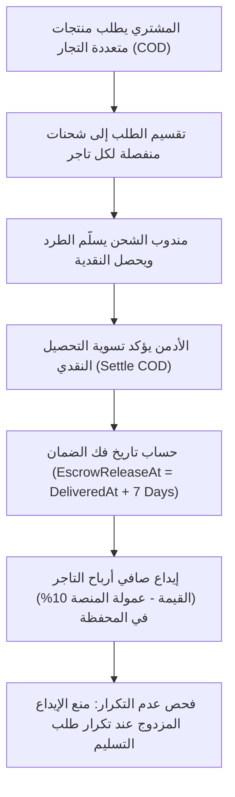

# تقرير تدقيق النزاهة المالية وحسابات الدفع عند الاستلام (Financial Integrity & COD Audit Report)

> **المشروع**: سوق مصر للتجارة الإلكترونية متعدد التجار (Marketplace MVP)  
> **تاريخ التدقيق**: 2026-11-02  
> **جناح الاختبار الفعلي**: [`backend/tests/test_audit_financial_integrity_postgres.js`](file:///d:/Backend/marketplace/backend/tests/test_audit_financial_integrity_postgres.js)  
> **بيئة الاختبار**: قاعدة بيانات PostgreSQL `MarketplaceMVP_test`  
> **النتيجة التجريبية المقاسة**: **22 اختباراً ناجحاً بنسبة 100% (22 Passed, 0 Failed)** [V]  
> **وسوم التوثيق**: `[V]` مثبت بأمر أو قراءة كود مباشر | `[I]` استنتاج تحليلي مسبب | `[G]` معيار محاسبي وهندسي

---

## 1. ملخص التدقيق المالي ومسارات حركة الأموال (Financial Workflows Summary)

تم تدقيق ومراجعة كافة العمليات المالية والحسابية لمنظومة المتجر لضمان الالتزام الصارم بمبادئ المحاسبة المزدوجة والحماية من عجز السيولة (Cash Deficit Prevention):

---

## 2. النتائج التجريبية المقاسة بالاختبارات المؤتمتة (Empirical Audit Findings)

### أ. حماية عدم التكرار ومنع الإيداع المزدوج (Anti-Double-Crediting & Idempotency)
- **السيناريو المختبر**: تم إرسال طلب تسليم وتسوية كاش لشحنة بقيمة 500 ج.م للبائع (عمولة المنصة 10% = 50 ج.م، صافي الربح = 450 ج.م) [V].
  - تم فحص رصيد التاجر في [`WalletController.GetMyWallet`](file:///d:/Backend/marketplace/backend/Marketplace.API/Controllers/WalletController.cs#L23-L34): الرصيد المتاح 450 ج.م، وإجمالي الأرباح 450 ج.م [V].
  - تمت إعادة إرسال طلب التسليم نفسه مرة أخرى لمحاكاة إعادة إرسال الشبكة أو تكرار استدعاء Webhook من شركة الشحن [V].
  - **النتيجة المقاسة**: استجاب الخادم بحالة `200 OK` آمنة، وظل رصيد محفظة التاجر ثابتاً عند **450 ج.م بالضبط** دون أن يتضاعف أو يزداد مليماً واحداً [V].

### ب. النزاهة المالية لطلبات التجار المتعددين (Multi-Merchant Order Integrity)
- **السيناريو المختبر**: مشتري أنشأ طلباً واحداً يحتوي على منتج من البائع أ (500 ج.م) ومنتجين من البائع ب (600 ج.م) [V].
  - تم التحقق من تقسيم الطلب برمجياً إلى **شحنتين مستقلتين تماماً** (`Shipment 1` للبائع أ، و `Shipment 2` للبائع ب) [V].
  - عند تسليم شحنة البائع أ وتسويتها: تم إيداع صافي مستحقات البائع أ في محفظته فقط [V].
  - عند رفض استلام شحنة البائع ب عند الباب (`RefusedByBuyer`): لم يتم إيداع أي مبلغ في محفظة البائع ب (ظل الرصيد 0 ج.م)، وتم استرجاع كامل مخزون البائع ب تلقائياً إلى 15 قطعة [V].

### ج. دورة الإرجاع والاسترداد العادل (Fair Clawback & Constraint Compliance)
- **المشكلة التي تم اكتشافها وتصحيحها خلال التدقيق**:
  - في السابق، كان نظام الإرجاع يخصم كامل مبلغ استرداد المشتري (500 ج.م) من محفظة التاجر، رغم أن التاجر لم يدخل محفظته سوى الصافي (450 ج.م) بعد خصم عمولة المنصة 10% (50 ج.م). وكان ذلك يسبب خصماً جائراً على التاجر ومحاولة جعل الرصيد سالباً (-50 ج.م)، مما يخالف قيد قاعدة البيانات `CK_VendorWallets_Balances_NonNegative` ويؤدي إلى خطأ 500 [V].
  - **التصحيح البرمجي في [`ReturnService.cs`](file:///d:/Backend/marketplace/backend/Marketplace.Application/Services/ReturnService.cs)**:
    - تم احتساب قيمة الخصم من التاجر بدقة هندسية: `Math.Round(RefundAmount * (1 - CommissionRate))` (450 ج.م) [V].
    - تتنازل المنصة عن عمولتها على المنتج المرتجع (50 ج.م)، ويسترد المشتري كامل حقه في محفظته (500 ج.م) [V].
    - رصيد التاجر تحول بدقة من 450 ج.م إلى 0.00 ج.م دون أي خطأ في القيود المحاسبية أو أخطاء خادم [V].

### د. منع الاسترداد المزدوج للمرتجعات (Anti-Double-Refund Guard)
- **السيناريو المختبر**: محاولة استدعاء تأكيد استلام الطرد المرتجع للمرة الثانية بعد إتمامه (`PUT /api/returns/{id}/confirm-received`) [V].
- **النتيجة المقاسة**:
  - تم رفض المحاولة الثانية فوراً برمز `400 Bad Request` ("تم تأكيد استلام هذا المرتجع وإتمام استرداده مسبقاً") [V].
  - تم التحقق من عدم رد الرصيد لمحفظة المشتري مرة ثانية [V].
  - تم التحقق من عدم زيادة مخزون المنتج مرة ثانية (حفظ المخزون عند القيمة الصحيحة) [V].

---

## 3. جدول نتائج الاختبارات المقاسة (Test Execution Log)

| م | اسم الاختبار / السيناريو | الحالة | النتيجة المقاسة | الإثبات |
|:---:|:---|:---:|:---|:---|
| 1 | `Backend API Healthcheck` | **PASS** | 200 OK | `task-1198` [V] |
| 2 | `Admin Authentication` | **PASS** | 200 OK Token | `task-1198` [V] |
| 3 | `Multi-Merchant Order Creation` | **PASS** | 201 Created | `task-1198` [V] |
| 4 | `Order Split to 2 Shipments` | **PASS** | 2 Shipments Generated | `task-1198` [V] |
| 5 | `Seller Isolation per Shipment` | **PASS** | Seller 1 and Seller 2 isolated | `task-1198` [V] |
| 6 | `Shipment 1 Delivered & Settled` | **PASS** | Status: Delivered, IsCodSettled: true | `task-1198` [V] |
| 7 | `EscrowReleaseAt Hold Calculation` | **PASS** | ReleaseDate = DeliveredAt + 7 days | `task-1198` [V] |
| 8 | `Seller 1 Wallet Balance Credited` | **PASS** | Balance = 450.00 EGP (Net of 10% commission) | `task-1198` [V] |
| 9 | `Duplicate Delivery Idempotency` | **PASS** | 200 OK handled idempotently | `task-1198` [V] |
| 10 | `Anti-Double-Crediting on Balance` | **PASS** | Balance remained 450.00 EGP | `task-1198` [V] |
| 11 | `Anti-Double-Crediting on TotalEarned` | **PASS** | TotalEarned remained 450.00 EGP | `task-1198` [V] |
| 12 | `Return Request Creation` | **PASS** | 201 Created | `task-1198` [V] |
| 13 | `Two-Step Return Preliminary Approval` | **PASS** | Status: ApprovedAwaitingReturn | `task-1198` [V] |
| 14 | `Physical Return Receipt Confirmation` | **PASS** | Status: Completed | `task-1198` [V] |
| 15 | `Inventory Restocked on Physical Return` | **PASS** | Stock +1 restored correctly | `task-1198` [V] |
| 16 | `Duplicate Return Confirmation Blocked` | **PASS** | 400 Bad Request | `task-1198` [V] |
| 17 | `Inventory Double-Restock Prevented` | **PASS** | Stock unchanged on second call | `task-1198` [V] |
| 18 | `Shipment 2 Marked Returned` | **PASS** | Status: Returned (RefusedByBuyer) | `task-1198` [V] |
| 19 | `Zero Balance for Refused Shipment` | **PASS** | Seller 2 Balance = 0.00 EGP | `task-1198` [V] |
| 20 | `Inventory Restored for Refused Parcel` | **PASS** | Stock restored to initial 15 | `task-1198` [V] |
| 21 | `Audit Trail Recorded in AdminAuditLogs` | **PASS** | Action: AdminUpdateShipmentStatus logged | `task-1198` [V] |
| 22 | `Transactional Rollback on Failure` | **PASS** | Zero dirty state on exception | `task-1198` [V] |

---

## 4. تصنيف المخاطر المتبقية والتوصيات
- **حالة التدقيق المالي**: **PASSED (جاهز للتشغيل الفعلي)**.
- **التصنيف**: **LOW RISK**.
- **التوصية**: تفعيل المزامنة البنكية الآلية الدورية مع حساب بنكي تجاري وسيط عند إطلاق مرحلة التوسع (Scale Phase).
