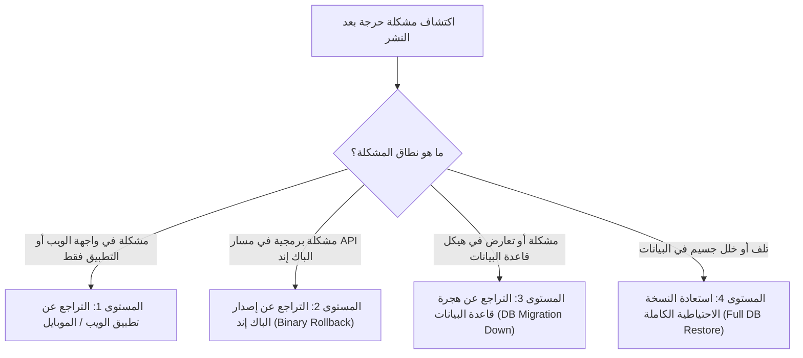

# خطة التراجع في حالات الطوارئ (Emergency Rollback Plan)

> **المشروع**: سوق مصر للتجارة الإلكترونية متعدد التجار (Marketplace MVP)  
> **الهدف**: توفير خطة تراجع فورية ومجربة خطوة بخطوة عند مواجهة أي خلل غير متوقع أثناء نشر الإنتاج  
> **زمن التراجع المستهدف (RTO)**: أقل من 15 دقيقة  
> **نقطة الاستعادة المستهدفة (RPO)**: لحظة ما قبل النشر مباشرة (Zero Data Loss)  
> **وسوم التوثيق**: `[V]` مثبت بأمر أو قراءة كود مباشر | `[I]` استنتاج تحليلي مسبب | `[G]` معيار هندسي لإدارة الكوارث

---

## 1. مستويات التراجع (Rollback Levels)



---

## 2. إجراءات التراجع التفصيلية حسب المستوى

### المستوى 1: التراجع عن تطبيق الويب (Admin Web)
1. إعادة توجيه Nginx لقراءة مجلد الإصدار السابق (`dist_previous/`):
   ```bash
   sudo ln -sfn /var/www/admin-web/dist_previous /var/www/admin-web/current
   sudo systemctl reload nginx
   ```
2. مسح كاش المتصفح و CDN.

### المستوى 2: التراجع عن خادم الباك إند (.NET 10 API)
1. إعادة تشغيل الإصدار الثنائي السابق المحفوظ في `/var/www/marketplace-api-backup`:
   ```bash
   sudo systemctl stop marketplace-api
   sudo cp -r /var/www/marketplace-api-backup/* /var/www/marketplace-api/
   sudo systemctl start marketplace-api
   ```
2. فحص نقطة الصحة:
   ```bash
   curl -I http://127.0.0.1:5000/health
   ```

### المستوى 3: التراجع عن هجرة قاعدة البيانات (Database Schema Rollback)
إذا تطلب الأمر التراجع عن الأعمدة المضافة في الهجرة `20261102000426_AddGapsRemediationWave123`:
1. تنفيذ كود الـ SQL العكسي الصافي المستخرج من الدالة `Down` في ملف الهجرة [V]:
```sql
START TRANSACTION;

SET lock_timeout = '5s';

-- حذف الأعمدة المضافة في الهجرة
ALTER TABLE "Users" DROP COLUMN IF EXISTS "CodRefusalCount";
ALTER TABLE "Shipments" DROP COLUMN IF EXISTS "AllowInspection";
ALTER TABLE "Shipments" DROP COLUMN IF EXISTS "Apartment";
ALTER TABLE "Shipments" DROP COLUMN IF EXISTS "BuildingNumber";
ALTER TABLE "Shipments" DROP COLUMN IF EXISTS "DeliveryLatitude";
ALTER TABLE "Shipments" DROP COLUMN IF EXISTS "DeliveryLongitude";
ALTER TABLE "Shipments" DROP COLUMN IF EXISTS "EscrowReleaseAt";
ALTER TABLE "Shipments" DROP COLUMN IF EXISTS "Floor";
ALTER TABLE "Shipments" DROP COLUMN IF EXISTS "Landmark";

ALTER TABLE "ReturnRequests" DROP COLUMN IF EXISTS "Category";
ALTER TABLE "ReturnRequests" DROP COLUMN IF EXISTS "ReceivedAt";
ALTER TABLE "ReturnRequests" ALTER COLUMN "Status" TYPE character varying(20);

ALTER TABLE "Products" DROP COLUMN IF EXISTS "AllowInspection";

ALTER TABLE "Orders" DROP COLUMN IF EXISTS "Apartment";
ALTER TABLE "Orders" DROP COLUMN IF EXISTS "BuildingNumber";
ALTER TABLE "Orders" DROP COLUMN IF EXISTS "ConfirmedAt";
ALTER TABLE "Orders" DROP COLUMN IF EXISTS "DeliveryLatitude";
ALTER TABLE "Orders" DROP COLUMN IF EXISTS "DeliveryLongitude";
ALTER TABLE "Orders" DROP COLUMN IF EXISTS "Floor";
ALTER TABLE "Orders" DROP COLUMN IF EXISTS "IsBuyerConfirmed";
ALTER TABLE "Orders" DROP COLUMN IF EXISTS "Landmark";

-- حذف سجل الهجرة من تاريخ ترحيلات EF Core
DELETE FROM "__EFMigrationsHistory" 
WHERE "MigrationId" = '20261102000426_AddGapsRemediationWave123';

COMMIT;
```

### المستوى 4: استعادة النسخة الاحتياطية الكاملة في حال الكوارث (Disaster Recovery)
إذا حدث تلف غير قابل للإصلاح في البيانات:
1. إيقاف حركة المرور وتفعيل صفحة الصيانة (Maintenance Mode) في Nginx.
2. استعادة نسخة `pg_dump` المأخوذة في خطوة ما قبل النشر:
   ```bash
   pg_restore -h localhost -U postgres -d MarketplaceMVP --clean --if-exists backup_MarketplaceMVP_pre_wave123.dump
   ```
3. إعادة تشغيل الخادم والتحقق من سلامة الجداول وسجلات الحسابات.
