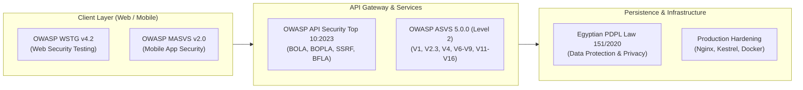

# Egypt Shop Marketplace — OWASP Standards Compliance Matrix

**Document Version**: 2.0.0 (Corrected ASVS 5.0.0 Mapping)  
**Target Scope**: ASP.NET Core 10 Backend, PostgreSQL Database, React 19 / Vite Web Frontend, React Native / Expo Mobile App  
**Standards Reference**:
- OWASP ASVS 5.0.0 (Application Security Verification Standard)
- OWASP API Security Top 10:2023
- OWASP MASVS v2.0 (Mobile Application Security Verification Standard) & MASTG
- OWASP WSTG v4.2 (Web Security Testing Guide)

---

## 1. OWASP API Security Top 10:2023 Mapping

| Vulnerability Category | ASVS 5.0.0 Mapping | Egypt Shop Defense Architecture | Code Implementation Reference | Automated & Verification Evidence |
| :--- | :--- | :--- | :--- | :--- |
| **API1:2023 Broken Object Level Authorization (BOLA / IDOR)** | **ASVS V8.2.2** (Object Level Authorization) | Explicit ownership verification in every query. Queries strictly filter by `UserId` or `SellerId` extracted from validated JWT claims. Unauthorized access returns 403 or 404, never 500. | `OrderService.cs`, `ProductService.cs`, `ReturnService.cs`, `ShipmentService.cs` | `test_audit_phase9_authorization_isolation_postgres.js` (Scenarios 1–6), `test_audit_phase15_security_certification_readiness_postgres.js` (Scenarios 7–10) |
| **API2:2023 Broken Authentication** | **ASVS V6.2.1, V7.1.1** (Authentication & Session Tokens) | BCrypt work factor >= 12, token version invalidation (`TokenVersion`), single-use refresh token rotation with family revocation on reuse, multi-key rate limiting. | `AuthService.cs`, `JwtService.cs`, `CsrfTokenService.cs`, `EgyptianPhoneValidation.cs` | `test_audit_phase4_auth_postgres.js`, `test_audit_phase14_security_monitoring_postgres.js` (Scenarios 4, 5, 8, 9), `test_audit_phase15_security_certification_readiness_postgres.js` (Scenarios 2–6) |
| **API3:2023 Broken Object Property Level Authorization (BOPLA)** | **ASVS V8.2.3** (Object Property Level Authorization) | Strict DTO segregation. Sensitive model fields (`IsActive`, `Role`, `Balance`, `IsCodSettled`, `CodRefusalCount`, `ItemsSubtotal`) cannot be mass-assigned from client requests. Server recalculates prices. | `UserDtos.cs`, `OrderDtos.cs`, `ProductDtos.cs`, `AuthValidators.cs`, `OrderService.cs` | `test_audit_phase10_financial_fraud_postgres.js` (Scenarios 1, 2, 16), `test_audit_phase15_security_certification_readiness_postgres.js` (Scenarios 13, 14) |
| **API4:2023 Unrestricted Resource Consumption** | **ASVS V1.3.4, V13.1.2** (Resource Limits & Request Throttling) | Kestrel 10 MB global request limit, 64 KB webhook limit, 8 max images per product, multi-key rate limiters (per IP, per authenticated user, per normalized phone/email target). | `Program.cs` (`RateLimiter`, Kestrel config), `ProductsController.cs` | `test_audit_phase12_infrastructure_hardening_postgres.js` (Tests 6, 12), `test_audit_phase11_webhooks_ssrf_postgres.js` (Scenario 8) |
| **API5:2023 Broken Function Level Authorization (BFLA)** | **ASVS V8.1.1, V8.1.2** (Function Level Access Control) | Role-based policies (`[Authorize(Roles = "Admin")]`, `[Authorize(Roles = "Seller")]`), runtime feature flag inactivation (`Admin:WebEnabled` kills `/admin` with 404), step-up 2FA on sensitive admin actions. | `AdminController.cs`, `SecurityController.cs`, `Program.cs` route filters | `test_audit_phase9_authorization_isolation_postgres.js` (Admin Suite), `test_audit_phase15_security_certification_readiness_postgres.js` (Scenarios 11, 12) |
| **API6:2023 Unrestricted Access to Sensitive Business Flows** | **ASVS V2.3.1, V2.3.2** (Business Logic & Concurrency Integrity) | Concurrency locks on scarce product checkout, single-use coupon redemption atomic check, idempotent order creation via `Idempotency-Key` header, anti-double-crediting for COD settlements. | `OrderService.cs` (`ExecuteSqlRawAsync`), `CouponService.cs`, `ShipmentService.cs` | `test_audit_phase10_financial_fraud_postgres.js` (Scenarios 5–13), `test_audit_phase15_security_certification_readiness_postgres.js` (Scenarios 15, 16) |
| **API7:2023 Server-Side Request Forgery (SSRF)** | **ASVS V1.3.6** (SSRF Prevention Architecture) | Strict URL parsing, destination IP address resolution validation, blocking of RFC1918 private ranges, loopback (`127.0.0.1`, `::1`), link-local, and cloud metadata (`169.254.169.254`). | `SsrfGuard.cs`, `DeliveryService.cs`, `WebhooksController.cs` | `test_audit_phase11_webhooks_ssrf_postgres.js` (Scenarios 13–20), `test_audit_phase15_security_certification_readiness_postgres.js` (Scenario 19) |
| **API8:2023 Security Misconfiguration** | **ASVS V13.1.1, V13.2.1** (Environment & Configuration Hardening) | Banner suppression (`Server: Kestrel` removed), Swagger UI completely disabled in non-development, strict CSP and HSTS headers, secure cookies (`__Host-` prefix in production), non-root Docker execution. | `Program.cs`, `SecurityHeadersMiddleware.cs`, `admin-web/nginx.conf.template`, `backend/Dockerfile` | `test_audit_phase12_infrastructure_hardening_postgres.js` (Tests 1–5, 13, 14), `test_audit_phase15_security_certification_readiness_postgres.js` (Scenario 20) |
| **API9:2023 Improper Inventory Management** | **ASVS V1.3.1, V13.1.3** (API Inventory & Endpoint Segmentation) | Route isolation for `/api/dev/*` carrier mocks (blocked with 404 in non-development), complete OpenAPI specification maintenance for sanctioned endpoints, security event catalogue. | `Program.cs` (`app.Use`), `DevCarrierController.cs`, `docs/security/security-event-catalogue.md` | `test_audit_phase12_infrastructure_hardening_postgres.js` (Test 3), `test_audit_phase14_security_monitoring_postgres.js` (Scenario 1) |
| **API10:2023 Unsafe Consumption of APIs** | **ASVS V4.3.1, V11.2.1** (Third-Party API Validation & HMAC) | Bosta webhook HMAC signature verification with constant-time comparison, replay tracking with 5-minute freshness window, schema validation before processing. | `WebhooksController.cs`, `BostaWebhookValidator.cs` | `test_audit_phase11_webhooks_ssrf_postgres.js` (Scenarios 1–10), `test_audit_phase15_security_certification_readiness_postgres.js` (Scenario 18) |

---

## 2. Corrected OWASP ASVS 5.0.0 Structural Mapping

The official OWASP ASVS 5.0.0 standard structures requirements into 16 core chapters. The table below traces each chapter to Egypt Shop's components:

```
+-------------------------------------------------------------------------------------------------+
| ASVS 5.0.0 CHAPTER            | CORE COVERAGE IN EGYPT SHOP MARKETPLACE                         |
+-------------------------------+-----------------------------------------------------------------+
| V1: Secure Architecture       | Multi-tenant boundaries, SSRF prevention (V1.3.6), layering    |
| V2: Validation & Logic        | FluentValidation rules, business logic concurrency (V2.3)       |
| V4: API & Web Services        | RESTful endpoints, webhook security (V4.3), JSON validation     |
| V5: File Handling             | Static upload constraints, magic-byte inspection, path traversal|
| V6: Authentication            | BCrypt cost >= 12, OTP generation, 2FA, lockout resistance      |
| V7: Session Management        | Token family rotation (V7.2), TokenVersion revocation, cookies  |
| V8: Authorization             | BOLA / IDOR (V8.2.2), BOPLA (V8.2.3), BFLA role enforcement     |
| V9: Self-contained Tokens     | JWT signing, claim validation, signature algorithm pinning      |
| V11: Cryptography             | BCrypt password hashing, HMAC SHA256 webhook signatures, CSPRNG |
| V12: Secure Communication     | TLS 1.3, HSTS header (max-age=31536000), internal service TLS  |
| V13: Configuration            | Kestrel banner suppression, Swagger disablement, unprivileged OS|
| V14: Data Protection          | Egyptian PDPL Law 151/2020 consent, PII masking, 72h protocol   |
| V15: Secure Coding & Supply   | CycloneDX SBOM, GitHub Actions commit pinning, Dependabot, SAST |
| V16: Logging & Error Handling | Structured SecurityEvents buffer, CRLF log injection stripping  |
+-------------------------------------------------------------------------------------------------+
```

---

## 3. High-Level Standards Correlation Matrix



Detailed requirement-level matrices are catalogued in companion documents:
- Detailed ASVS Level 2 Verification Record: [`04-asvs-level2-verification-matrix.md`](file:///d:/Backend/marketplace/docs/security/pentest/04-asvs-level2-verification-matrix.md)
- Mobile MASVS Android / iOS Matrix: [`05-mobile-masvs-evidence-matrix.md`](file:///d:/Backend/marketplace/docs/security/pentest/05-mobile-masvs-evidence-matrix.md)
- Web WSTG v4.2 Verification Matrix: [`06-web-wstg-test-matrix.md`](file:///d:/Backend/marketplace/docs/security/pentest/06-web-wstg-test-matrix.md)
